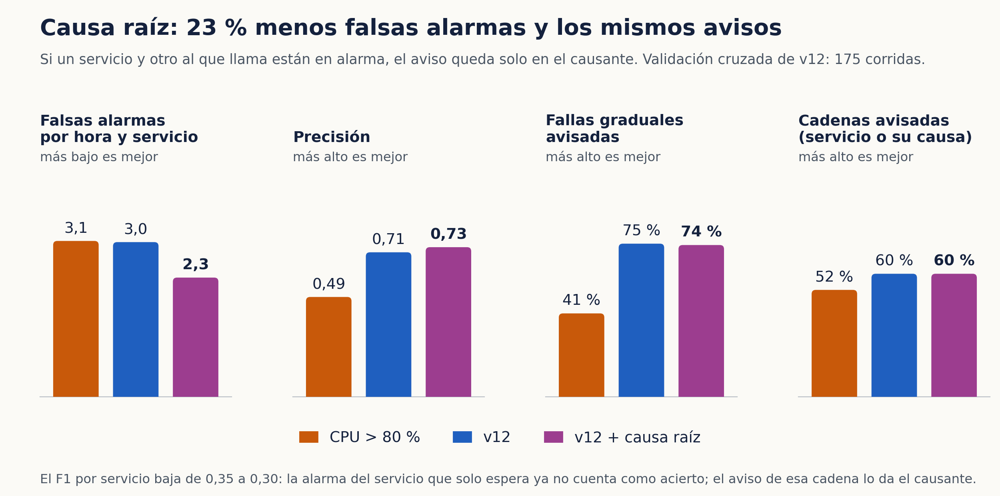
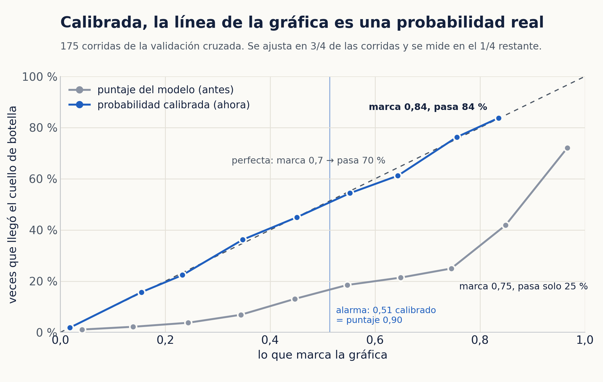

# Guía del proyecto: variables, campañas y arquitecturas

Proyecto P1 — *Microservice Bottleneck Prediction* (Sistemas en la Nube).
Esta guía explica **qué medimos, por qué, cómo se genera cada dato, qué parámetros tiene cada experimento y cómo funciona cada arquitectura** (los microservicios, el pipeline de datos y el modelo). Está escrita para consultarla cuando te pierdas: cada sección es independiente.

**Para instalarlo y ponerlo a funcionar, empieza por la [sección 0](#0-cómo-ejecutar-el-proyecto).**

---

## Índice

0. [Cómo ejecutar el proyecto](#0-cómo-ejecutar-el-proyecto)
1. [La idea completa en un minuto](#1-la-idea-completa-en-un-minuto)
2. [Arquitectura 1: los 6 microservicios](#2-arquitectura-1-los-6-microservicios)
3. [Conceptos previos (glosario corto)](#3-conceptos-previos-glosario-corto)
4. [Variables que recolectamos](#4-variables-que-recolectamos)
5. [Qué archivos genera cada corrida](#5-qué-archivos-genera-cada-corrida)
6. [Parámetros de los experimentos y las campañas](#6-parámetros-de-los-experimentos-y-las-campañas)
7. [Etiquetado: cómo decidimos que hay un cuello de botella](#7-etiquetado-cómo-decidimos-que-hay-un-cuello-de-botella)
8. [Arquitectura 2: el pipeline de datos y código](#8-arquitectura-2-el-pipeline-de-datos-y-código)
9. [Arquitectura 3: el baseline y el modelo LSTM](#9-arquitectura-3-el-baseline-y-el-modelo-lstm)
10. [Métricas de evaluación](#10-métricas-de-evaluación)
11. [Comandos en orden](#11-comandos-en-orden)
12. [Limitaciones que debes conocer](#12-limitaciones-que-debes-conocer)
13. [Resultados del modelo final (v12)](#13-resultados-del-modelo-final-v12)
14. [Demo](#14-demo)

---

## 0. Cómo ejecutar el proyecto

Todos los comandos se corren en PowerShell, desde la raíz del proyecto.

### 0.1 Requisitos

| Necesitas | Versión probada | Para qué |
| --- | --- | --- |
| Docker Desktop con Compose | Docker 28.3.2, Compose 2.38.2 | Los 6 microservicios |
| Python | 3.8.3 | Recolector, Locust, inyector, modelo y gráficas |
| Git Bash (opcional) | | Solo para los scripts `ml/pipeline_*.sh` |

El proyecto se probó en una laptop con Windows 11, Intel i7-11800H (8 núcleos) y 15,8 GB de RAM. Los contenedores usan hasta 6 CPU y 1,5 GB de RAM en total. Como todo corre en la misma máquina, **conecta el cargador y cierra los programas pesados antes de medir** (sección 6.4).

### 0.2 Instalación

```powershell
git clone https://github.com/grazia6666/boleteria.git
cd boleteria
pip install torch==2.4.1 numpy==1.24.4 pandas==2.0.3 matplotlib==3.7.5 locust==2.25.0 docker==7.2.0 requests==2.32.4 prometheus-client==0.21.1
docker compose up -d --build
```

Estas son las versiones con las que se probó. No uses `requirements-tools.txt`: sus versiones no instalan en Python 3.8 y no incluye `torch` ni `matplotlib`. Las dependencias de los servicios se instalan solas dentro de cada imagen (Python 3.12, `servicios/<servicio>/requirements.txt`).

Después de instalar, consigue los datos (sección 0.4).

### 0.3 Configuración

El proyecto no usa archivos `.env`. La configuración está en `docker-compose.yml` y en los parámetros de cada comando.

| Servicio | Puerto local | Variables propias |
| --- | --- | --- |
| `usuarios` | 8001 | |
| `eventos` | 8002 | |
| `reservaciones` | 8003 | `USUARIOS_URL`, `EVENTOS_URL`, `PAGO_URL` |
| `pago` | 8004 | `TICKET_URL` |
| `ticket` | 8005 | `NOTIFICACIONES_URL` |
| `notificaciones` | 8006 | |

Los 6 servicios escuchan en el puerto interno 8000 y comparten `SERVICE_NAME`, `BASE_DELAY_MS=5`, `CPU_LOAD=0`, `cpus: 1.0` y `mem_limit: 256m`. Si cambias `cpus`, cambia también `CPU_LIMIT` en `collector/collector.py`. El modelo se entrenó con estos límites: si los cambias, sus resultados dejan de ser comparables.

| Qué se configura | Dónde | Valores usados | Detalle |
| --- | --- | --- | --- |
| Muestreo | `collector.py --interval` | 1 s | Sección 4.1 |
| Carga | `run_experiment.py` | `--scenario`, `--duration`, `--base-users` (15), `--peak-users` (100) y las opciones `--burst-*` | Secciones 6.1 y 6.3 |
| Fallas | `run_experiment.py --inject` | `servicio:inicio:duracion:cpu_load[:rampa]` | Sección 6.2 |
| Cuello de botella real | `ml/etiquetar.py` | p95 > máx(3 × mediana, 150 ms) durante ≥ 3 s y tiempo propio > 50 ms | Sección 7.2 |
| Modelo final | `data/resultados_v12/modelo_ensamble.json` | 3 LSTM, umbral 0,90, ventana de 30 s, horizonte de 30 s | Sección 9.3 |
| Control de calidad | `FACTOR_CONTAMINADA` en `run_campaign.py` | Contaminada si supera 1,5 × el costo normal | Sección 6.4 |
| Demo | `ml/demo.py` | Espera 60 s con tráfico antes de predecir; `--umbral`, `--log`, `--sin-pantalla`, `--duracion` | Sección 14 |

### 0.4 Datos necesarios

**El repositorio solo trae el código.** La carpeta `data/` y los modelos `*.pt` están en `.gitignore`, así que después de clonar no hay corridas ni modelo entrenado. Hay dos formas de tenerlos:

1. **Copiar la carpeta `data/`** del equipo original a la raíz del proyecto (1,1 GB; los resultados y el modelo de v12 ocupan 112 MB).
2. **Regenerarla** con la sección 11: 175 corridas válidas (18,5 h de carga, más los reinicios entre corridas) y unos 20 min de entrenamiento.

El dataset tiene 107 corridas de carga normal, 26 progresivas y 42 de ráfagas. Esto necesita cada comando dentro de `data/`:

| Comando | Docker | Archivos en `data/` |
| --- | --- | --- |
| `run_experiment.py` | Sí | Ninguno: crea `<run_id>/` |
| `ml/graficar_corrida.py` | No | `<run_id>/metrics.csv`, `events.csv` y `meta.json` |
| `ml/demo.py` (en vivo) | Sí | `resultados_v12/modelo_ensamble.json`, `resultados_v12/s1`, `s2` y `s3/models/lstm_final.pt`, `umbrales_propio.json`; `resultados_v12/calibracion.json` (si no está, muestra el puntaje sin calibrar) |
| `ml/demo.py --replay <run>` | No | `resultados_v12/predicciones.csv`, `config.json` y `calibracion.json`, `<run>/metrics.csv` y `meta.json` |
| `ml/calibrar.py` | No | `resultados_v12/predicciones.csv` y `modelo_ensamble.json`; crea `resultados_v12/calibracion.json` |
| `ml/causa_raiz.py` | No | `resultados_v12/predicciones.csv` y `config.json`, `dataset_etiquetado_propio.csv`, `episodios_propio.csv` |
| `ml/evidencia_vivo.py --run <run>` | No | Lo que grabó la corrida, `normal_base_r1` a `r4`, el modelo v12, `resultados_v12/predicciones.csv` y el `meta.json` de las 175 corridas |
| `ml/evidencia_lead.py --run <run>` | No | `resultados_v12/predicciones.csv` y `config.json`, `<run>/metrics.csv` y `meta.json`, `episodios_propio.csv`, `umbrales_propio.json`, `dataset_etiquetado_propio.csv` |
| `ml/verificar_vivo.py chequeo` | Sí | `normal_base_r1` a `r4` |
| `ml/verificar_vivo.py evaluar` | No | `vivo/`, el modelo v12, `resultados_v12/por_escenario_carga.csv` |
| `ml/etiquetar.py` | No | `dataset_metrics.csv`, `dataset_edges.csv` |
| `ml/baseline.py`, `ml/entrenar.py` | No | `dataset_etiquetado_propio.csv`, `episodios_propio.csv` |

Los archivos de cada corrida se explican en la sección 5.

### 0.5 Ejecución

**1. Levantar los servicios y comprobar la máquina**

```powershell
docker compose up -d
docker compose ps                        # los 6 deben decir Up
python ml/verificar_vivo.py chequeo      # ~2 min: dice MAQUINA OK o MAQUINA LENTA
```

**2. Ver el modelo sin Docker (modo repetición).** Reproduce una corrida grabada y siempre muestra lo mismo:

```powershell
python ml/demo.py --replay rnd_lenta_06 --velocidad 2        # carga normal, falla lenta en ticket
python ml/demo.py --replay rnd_progresivo_12 --velocidad 2   # carga progresiva
python ml/demo.py --replay rnd_rampa_04 --velocidad 2        # ráfagas que suben en 60 s
```

**3. Correr un experimento en vivo.** Abre la demo en una terminal:

```powershell
docker compose restart      # estado limpio de los servicios
python ml/demo.py
```

Y en otra terminal corre uno de estos:

```powershell
python run_experiment.py --scenario normal --duration 300 --run-id demo_normal_1 --inject usuarios:70:170:90:90
python run_experiment.py --scenario progresivo --duration 360 --peak-users 60 --run-id demo_progresivo_1 --inject notificaciones:100:90:90:60
python run_experiment.py --scenario burst --duration 420 --peak-users 70 --burst-times 74,221 --burst-len 34 --burst-ramp 60 --run-id demo_burst_1
```

Usa un `--run-id` nuevo en cada corrida, porque si repites uno se reemplaza la anterior. Espera a que salga `Listo -> ...` antes de graficar.

**4. Graficar una corrida**

```powershell
python ml/evidencia_vivo.py --run demo_normal_1          # corrida nueva: predicción, inicio real y Lead Time por servicio
python ml/evidencia_lead.py --run rnd_lenta_06           # corrida del entrenamiento (validación cruzada)
python ml/graficar_corrida.py data/demo_normal_1 --log   # solo métricas, sin el modelo
```

Las dos primeras generan un `.png` y un `.csv`, y la tercera un `grafica.png` dentro de la carpeta de la corrida. La sección 14.4 explica cómo leerlas.

**5. Apagar**

```powershell
docker compose stop
```

**Problemas comunes**

| Qué pasa | Causa | Solución |
| --- | --- | --- |
| Error al conectar con Docker | Docker Desktop está cerrado | Ábrelo y espera 2 o 3 min |
| `MAQUINA LENTA` en el chequeo | Sin cargador o con programas pesados abiertos | Conecta el cargador, cierra programas y repite el chequeo |
| `No such file` o `FileNotFoundError` dentro de `data/` | Faltan los datos | Sección 0.4 |
| `La corrida ... no esta en .../predicciones.csv` | Es una corrida nueva, y `--replay` y `evidencia_lead.py` solo sirven para las del entrenamiento | Usa `ml/evidencia_vivo.py` |
| Un servicio sigue lento tras cerrar una corrida a la fuerza | La falla quedó activa | `python loadtest/inyector.py --reset` |

---

## 1. La idea completa en un minuto

1. Tenemos **6 microservicios** (una boletería) que se llaman entre sí.
2. Les mandamos **tráfico simulado** (Locust) y, a propósito, **les provocamos cuellos de botella** (inyector) en momentos conocidos.
3. Un **recolector** mide cada servicio cada segundo (CPU, RAM, latencia, peticiones por segundo, cola, errores) y guarda todo en CSV.
4. Un script de **etiquetado** decide, mirando la latencia, en qué instantes cada servicio estaba en cuello de botella **por su propio trabajo** (no por esperar a otro servicio), y marca los **30 segundos anteriores** como "se viene un cuello de botella".
5. Comparamos dos formas de predecirlo:
   - **Baseline:** una regla fija ("alarma si CPU > 80 %").
   - **LSTM:** una red neuronal que mira los últimos 30 s de métricas del servicio **y de los servicios a los que llama**, y estima la probabilidad de que haya un cuello de botella en los próximos 30 s.
6. Medimos con **Precision, Recall, F1, falsas alarmas por hora y Prediction Lead Time** (cuántos segundos antes avisamos, contado de forma honesta).

**Resultado del modelo final (v12, ensamble de 3 LSTM, 175 corridas):** se mide en **95 corridas de calendario aleatorio** (fallas y ráfagas en orden y momentos al azar), donde el modelo no puede "adivinar" por el horario del experimento. Ahí v12 logra precisión 0,76, F1 0,35 y 2,0 falsas alarmas por hora de servicio, contra F1 0,10–0,18 de la regla de CPU. Anticipa lo que se arma de a poco: fallas lentas (~20 s), crecimiento progresivo (15–26 s según el umbral) y ráfagas que suben en rampa (~10–13 s). Las ráfagas instantáneas y las fallas abruptas no dejan señal previa: solo se detectan al empezar. Su punto débil son las **caídas en cadena** (un servicio se atasca esperando a otro que falla): avisa antes en el servicio atascado o en el que depende el 56 % de las veces. Detalle en la [sección 13](#13-resultados-del-modelo-final-v12).

```
tráfico (Locust) ──► microservicios ──► recolector ──► CSV ──► etiquetado ──► baseline / LSTM ──► métricas
                          ▲
                inyector (provoca cuellos de botella)
```

---

## 2. Arquitectura 1: los 6 microservicios

Todos son aplicaciones **FastAPI** (Python) en contenedores **Docker**, orquestados con `docker-compose.yml`. Cada contenedor tiene un límite de **1 CPU y 256 MB de RAM**. Ese límite importa: el "100 % de CPU" que medimos es relativo a esa 1 CPU, y por eso un servicio puede saturarse de verdad.

### 2.1 Quién llama a quién

```
                        ┌──────────► usuarios        (8001)
 Locust ──► reservaciones (8003) ────► eventos         (8002)
 (tráfico)              └──────────► pago            (8004) ──► ticket (8005) ──► notificaciones (8006)
```

- Locust **solo** habla con `reservaciones`: cada reserva (`POST /reservations`) dispara llamadas en cadena.
- `reservaciones` llama a `usuarios`, `eventos` y `pago`.
- `pago` llama a `ticket`; `ticket` llama a `notificaciones`.
- **La cadena más larga tiene 4 servicios:** `reservaciones → pago → ticket → notificaciones`.

### 2.2 Qué hace cada servicio

| Servicio | Puerto (host) | Rol en la boletería | Endpoints principales | Llama a |
| --- | --- | --- | --- | --- |
| `usuarios` | 8001 | Registro y consulta de usuarios | `POST/GET /users`, `GET /users/{id}` | nadie |
| `eventos` | 8002 | Catálogo de eventos y entradas disponibles | `GET/POST /events`, `GET /events/{id}`, `POST /events/{id}/reserve` | nadie |
| `reservaciones` | 8003 | **Orquestador**: crea la reserva | `POST/GET /reservations`, `GET /reservations/{id}` | usuarios, eventos, pago |
| `pago` | 8004 | Procesa el pago | `POST/GET /payments` | ticket |
| `ticket` | 8005 | Genera el ticket | `POST/GET /tickets` | notificaciones |
| `notificaciones` | 8006 | Envía la notificación final | `POST/GET /notifications` | nadie |

Dentro de la red de Docker cada servicio escucha en el puerto 8000; los puertos 8001–8006 son los que se ven desde tu PC.

### 2.3 El archivo `common.py` (idéntico en los 6)

Es el "motor común" de todos los servicios. Aporta:

| Pieza | Qué hace | Por qué nos sirve |
| --- | --- | --- |
| `config` (`base_delay_ms`, `cpu_load`) | Parámetros de comportamiento modificables en vivo | Permiten provocar cuellos de botella |
| `simulate_work()` | Espera `base_delay_ms` (por defecto 5 ms) y luego hace un bucle de CPU de `cpu_load × 10.000` iteraciones | Con `cpu_load=0` el servicio es rápido; al subirlo consume CPU real y se satura |
| `call_service()` | Llama a otro servicio, mide cuánto tardó esa llamada y devuelve 502 si falla | Genera las métricas de **aristas** (dependencias) |
| Middleware de métricas | Cuenta peticiones, mide su duración y cuántas hay en curso | Genera las variables que recolectamos |
| `GET /health` | Responde si el servicio está vivo | Verificación previa de la campaña |
| `GET /metrics` | Expone las métricas en formato Prometheus | De aquí lee el recolector |
| `GET/POST /admin/load` | Lee o cambia `cpu_load` y `base_delay_ms` | **Es el mecanismo de inyección de cuellos de botella** |

### 2.4 Las métricas que expone cada servicio (Prometheus)

| Métrica | Tipo | Etiquetas | Qué cuenta |
| --- | --- | --- | --- |
| `http_requests_total` | Counter | service, method, path, status | Peticiones atendidas (acumulado) |
| `http_request_duration_seconds` | Histogram | service, path | Latencia de cada petición, en cubetas |
| `http_requests_in_flight` | Gauge | service | Peticiones que están siendo atendidas **ahora** |
| `downstream_request_duration_seconds` | Histogram | service, target | Latencia de las llamadas a otros servicios |
| `downstream_requests_total` | Counter | service, target, status | Cuántas llamadas a otros servicios y con qué resultado |

Las cubetas (*buckets*) del histograma son finas, de 5 ms a 30 s: `0.005, 0.01, 0.025, 0.05, 0.1, 0.15, 0.25, 0.4, 0.6, 0.8, 1, 1.5, 2, 3, 4, 6, 8, 12, 20, 30` segundos. Eso permite estimar percentiles con razonable precisión alrededor de 100–400 ms, que es donde vive nuestro umbral.

> **Counter vs Gauge vs Histogram.** Un *counter* solo crece (hay que restar dos lecturas para obtener una tasa). Un *gauge* sube y baja (valor instantáneo). Un *histogram* cuenta cuántas observaciones cayeron en cada rango; de ahí salen medias y percentiles.

---

## 3. Conceptos previos (glosario corto)

| Concepto | Explicación sencilla |
| --- | --- |
| **Cuello de botella** | Un servicio no da abasto: sus peticiones empiezan a tardar mucho más de lo normal (o dejan de responder). |
| **Saturación** | La CPU (o el recurso) está al límite; es una causa típica de cuello de botella. |
| **Propagación** | Un servicio lento hace que quien lo llama también se vuelva lento, aunque su CPU esté tranquila. |
| **Latencia** | Cuánto tarda una petición en responderse. |
| **p95** | El valor por debajo del cual está el 95 % de las latencias. Muestra las peticiones lentas que la media oculta. |
| **Throughput / rps** | Peticiones por segundo que atiende el servicio. |
| **Cola** | Peticiones esperando o en curso. Aquí usamos *peticiones en vuelo* como aproximación. |
| **Ventana** | Los últimos *W* segundos de métricas que ve el modelo (aquí W = 30 s). |
| **Horizonte** | Cuánto hacia el futuro predecimos (aquí H = 30 s). |
| **Episodio** | Un tramo continuo de cuello de botella en un servicio (de inicio a fin). |
| **Inyección** | Provocar un cuello de botella a propósito con `/admin/load`. |
| **Escenario** | El patrón de tráfico: normal, progresivo o ráfaga. |
| **Corrida (run)** | Un experimento completo con un escenario y unas inyecciones; deja su carpeta en `data/<run_id>/`. |
| **Campaña** | El conjunto de corridas que se ejecutan en cadena (`run_campaign.py`). |

---

## 4. Variables que recolectamos

El recolector (`collector/collector.py`) toma **una muestra por segundo y por servicio**. Mezcla dos fuentes:

- **Docker** (`docker stats`): CPU y RAM del contenedor.
- **Prometheus `/metrics`** de cada servicio: peticiones, latencia, cola, errores.

### 4.1 `metrics.csv`: una fila por servicio y por segundo

| Columna | Unidad | Qué es | Cómo se calcula | Cómo leerla |
| --- | --- | --- | --- | --- |
| `timestamp` | s (época) | Momento de la muestra | Reloj del recolector | Sirve para alinear con eventos |
| `servicio` | texto | Cuál de los 6 | Nombre del contenedor | Entrada del modelo (one-hot) |
| `cpu` | % | Uso de CPU del contenedor | `docker stats`, relativo al límite de 1 CPU | 100 % = saturado. Sube por carga o por inyección |
| `ram_mb` | MB | Memoria usada | `docker stats` | Cambia poco aquí; útil para detectar fugas |
| `rps` | req/s | Peticiones atendidas por segundo | Δ`http_requests_total` / Δtiempo | Tráfico que recibe el servicio. Puede dar saltos por muestreo irregular |
| `lat_mean_ms` | ms | Latencia media en el intervalo | Δsuma de duraciones / Δnúmero de peticiones | Sube cuando el servicio se degrada |
| `lat_p95_ms` | ms | Latencia p95 en el intervalo | Se interpola dentro de las cubetas del histograma | Es la **señal principal de cuello de botella** (el etiquetado se basa en ella) |
| `cola` | peticiones | Peticiones en curso | Gauge `http_requests_in_flight` | Si crece, el servicio no da abasto. Es el mejor indicador adelantado |
| `err_rps` | err/s | Respuestas con error por segundo | Δ de peticiones con estado 5xx o `error` | Fallos visibles (por ejemplo 502 por una dependencia caída) |
| `scrape_ok` | 0 / 1 | ¿Respondió `/metrics` a tiempo? | 1 si hubo respuesta antes de 0,9 s | `0` durante saturación fuerte; esas filas traen latencias vacías |

**Detalles que conviene recordar**

- El p95 es una **estimación** a partir de cubetas, no el percentil exacto.
- Cuando `scrape_ok = 0` el servicio estaba tan saturado que no contestó a la medición; **eso mismo es señal de cuello de botella** y el etiquetado lo trata como tal.
- En las corridas ya hechas (recolector anterior) el muestreo era irregular; `ml/datos.py` las remuestrea a una rejilla de 1 s.

### 4.2 `edges.csv`: una fila por dependencia y por segundo

Mide cada **arista** origen → destino (por ejemplo `reservaciones → pago`).

| Columna | Unidad | Qué es |
| --- | --- | --- |
| `timestamp` | s | Momento |
| `origen`, `destino` | texto | Quién llama y a quién |
| `cps` | llamadas/s | Llamadas por segundo por esa arista |
| `lat_mean_ms`, `lat_p95_ms` | ms | Latencia de esa llamada vista **desde el origen** (incluye red y espera) |
| `err_ps` | err/s | Llamadas fallidas por segundo |

Sirve para ver **dónde** se propaga un problema. En P1 se usa en el **etiquetado**: con ella se calcula el **tiempo propio** de cada servicio (latencia media menos lo que tardaron sus llamadas a otros), que distingue un cuello de botella real de un servicio que solo está esperando (sección 7). El LSTM no lee `edges.csv` directamente; ve el estado de sus dependencias a través de `metrics.csv` (sección 9.1).

### 4.3 `events.csv`: qué inyectamos y cuándo (verdad conocida)

| Columna | Qué es |
| --- | --- |
| `run_id` | Corrida |
| `escenario` | normal / progresivo / burst |
| `servicio` | Servicio al que se inyectó carga |
| `t_inicio`, `t_fin` | Instante real de inicio y fin (época, en segundos) |
| `cpu_load` | Intensidad aplicada (multiplica el bucle de CPU) |
| `rampa_s` | Segundos que tardó en llegar a la intensidad final. `0` = salto abrupto; `>0` = subida gradual |

> **Ojo:** `events.csv` dice lo que *provocamos*, no lo que *ocurrió*. La etiqueta de cuello de botella se deriva después de los síntomas observados.

### 4.4 Columnas que añade la consolidación (`dataset_metrics.csv`)

| Columna | Significado |
| --- | --- |
| `run_id` | Identificador de la corrida |
| `escenario` | Escenario de tráfico |
| `t_rel` | Segundos desde el inicio de la carga |
| `en_carga` | 1 si ya había tráfico en ese instante |
| `inj_servicio` | 1 si **ese** servicio tenía inyección activa |
| `inj_alguna` | 1 si algún servicio tenía inyección activa |
| `inj_tipo` | `gradual` o `abrupto` |

### 4.5 Lo que **no** medimos (y por qué)

- **Ancho de banda de red, disco:** en este sistema no son el factor limitante.
- **Trazas distribuidas (ids de petición):** quedan para P2.
- **Tráfico real:** todo es simulado y usa siempre el mismo usuario (`user_id=1`).

---

## 5. Qué archivos genera cada corrida

En `data/<run_id>/`:

| Archivo | Contenido |
| --- | --- |
| `metrics.csv` | Variables por servicio y segundo (sección 4.1) |
| `edges.csv` | Variables por dependencia (sección 4.2) |
| `events.csv` | Inyecciones reales (sección 4.3) |
| `locust_*.csv` | Estadísticas de Locust: lo que vieron los usuarios simulados (peticiones, fallos, tiempos) |
| `meta.json` | Parámetros usados: escenario, duración, usuarios, inyecciones |
| `OK` | Marca de corrida completa y válida (la campaña salta las que ya la tienen) |
| `CONTAMINADA` | Solo si la corrida no pasó el control de calidad (sección 6.4); no recibe `OK` y se repite |

Y tras consolidar, en `data/`: `dataset_metrics.csv`, `dataset_edges.csv`, `resumen_corridas.csv` (una fila por corrida) y `calidad_corridas.csv` (resultado del control de calidad de cada corrida).

---

## 6. Parámetros de los experimentos y las campañas

### 6.1 Los escenarios de tráfico (`loadtest/locustfile.py`)

Locust crea **usuarios virtuales en bucle cerrado**: cada usuario hace una petición, espera la respuesta y repite. Un usuario genera unas 1,25 req/s. Si el sistema se lentifica, los usuarios esperan más y generan menos tráfico (por eso el sistema "se frena solo").

| Escenario | Cómo es la carga | Para qué sirve |
| --- | --- | --- |
| **normal** | Usuarios constantes (`--base-users`, 15 por defecto) | Línea base y base para inyectar cuellos de botella |
| **progresivo** | Crece de 5 usuarios hasta `--peak-users` (60) y vuelve a bajar, en forma de triángulo (≈65 % del tiempo subiendo) | Saturación natural y gradual |
| **burst** | Carga base con **ráfagas** a `--peak-users` (70): la primera a los 60 s, luego cada 120 s, de 25 s de duración. Con `BURST_TIMES` las ráfagas empiezan en los segundos indicados (calendario irregular) | Picos bruscos de tráfico |

Parámetros de entorno de Locust: `SCENARIO`, `DURATION`, `BASE_USERS`, `PEAK_USERS`, `BURST_START=60`, `BURST_EVERY=120`, `BURST_LEN=25`, `BURST_TIMES` (lista de inicios separados por coma; si está, reemplaza a `BURST_START`/`BURST_EVERY`).

### 6.2 El inyector (`loadtest/inyector.py`)

Formato: `--inject servicio:inicio:duracion:cpu_load[:rampa]`

| Parte | Significado | Ejemplo `pago:60:90:150:40` |
| --- | --- | --- |
| `servicio` | A quién se inyecta | `pago` |
| `inicio` | Segundo (desde el inicio de la corrida) en que empieza | 60 |
| `duracion` | Cuánto dura | 90 s |
| `cpu_load` | Intensidad final (× 10.000 iteraciones por petición) | 150 |
| `rampa` (opcional) | Segundos para subir de 0 a `cpu_load` (1 escalón por segundo). Sin rampa = salto directo | 40 s |

Al terminar, el inyector **restablece** el servicio (`--reset`). También escribe `events.csv` con los tiempos reales. Cada inyección corre en paralelo: fallas en servicios distintos pueden solaparse (fallas simultáneas; el modelo todavía no se entrenó con ellas), y dos fallas solapadas en el mismo servicio se rechazan. Si un servicio saturado tarda en responder, el inyector reintenta en vez de caerse.

### 6.3 Una corrida (`run_experiment.py`)

Lanza a la vez el recolector, Locust y el inyector, y guarda todo en `data/<run_id>/`.

| Parámetro | Defecto | Significado |
| --- | --- | --- |
| `--scenario` | (obligatorio) | normal / progresivo / burst |
| `--duration` | 600 | Duración en segundos |
| `--inject` | ninguno | Inyecciones (se puede repetir) |
| `--base-users` | 15 | Usuarios base |
| `--peak-users` | 100 | Usuarios en el pico |
| `--run-id` | auto | Nombre de la carpeta |
| `--burst-times` | ninguno | Inicios de las ráfagas en burst, p. ej. `67,179,329` (calendario irregular) |
| `--burst-len` | 25 | Duración de cada ráfaga (s) |
| `--burst-ramp` | 0 | Segundos que tarda cada ráfaga en subir de los usuarios base al pico (0 = de golpe) |

Ejemplo: `python run_experiment.py --scenario normal --duration 150 --inject pago:40:60:150`

### 6.4 La campaña (`run_campaign.py`)

Ejecuta todas las corridas en cadena. Entre una y otra **reinicia los contenedores** (estado limpio) y espera `--cooldown` s.

| Parámetro | Defecto | Significado |
| --- | --- | --- |
| `--reps` | 1 | Repeticiones de cada combinación (`--reps 2` duplica la campaña) |
| `--load` | 150 | `cpu_load` final de las inyecciones en `normal_inj` y `burst_inj` |
| `--only` | todos | Grupos a correr, separados por coma |
| `--cooldown` | 20 | Pausa entre corridas (s) |
| `--dry-run` | no | Muestra el plan y el tiempo estimado sin ejecutar |
| `--solo-consolidar` | no | No corre nada; solo une lo ya hecho |
| `--sin-consolidar` | no | Corre pero no consolida al final |
| `--sin-chequeo` | no | Omite la verificación previa |
| `--repetir-contaminadas` | no | Quita la marca `OK` a las corridas que no pasan el control de calidad, para repetirlas |
| `--aceptar-contaminadas` | no | Marca `OK` una corrida nueva aunque no pase el control de calidad |

**Control de calidad.** Todo corre en una sola máquina, así que si la laptop está ocupada (otro programa, un entrenamiento, modo ahorro de energía) los servicios gastan más CPU por el mismo trabajo y la corrida queda contaminada. Al terminar cada corrida se mide la **CPU total del sistema por petición antes de la primera inyección**; si supera **1,5 ×** la de `normal_base`, la corrida no recibe `OK`, deja un archivo `CONTAMINADA` y se repite la próxima vez. Así se detectaron y repitieron 10 corridas grabadas con la máquina al doble de su costo normal. **No entrenes ni corras nada pesado mientras haya una campaña activa.**

La **verificación previa** comprueba que los 6 servicios responden, que una reserva atraviesa toda la cadena y que los contenedores tienen el `common.py` nuevo (métricas de dependencias y cubetas finas). Así no se pierden horas con código viejo.

Si interrumpes con Ctrl+C, consolida lo terminado; al reanudar, **salta** las corridas con marca `OK` y repite la incompleta.

### 6.5 El plan de la campaña (`--reps 1` = 40 corridas, ≈ 4,7 h; `--reps 2` = 80 corridas)

| Grupo | Corridas | Escenario | Duración | Usuarios | Inyección |
| --- | --- | --- | --- | --- | --- |
| `normal_base` | 2 | normal | 300 s | 15 | Ninguna (negativos limpios; de aquí salen los umbrales) |
| `normal_inj` | 6 (una por servicio) | normal | 360 s | 15 | Gradual `s:60:90:150:40` (rampa de 40 s) y abrupta `s:220:60:150` |
| `burst_inj` | 6 (una por servicio) | burst | 360 s | 15 base, pico 70 | Gradual `s:95:75:150:30` y abrupta `s:215:75:150`, esquivando las ráfagas (que caen en 60–85, 180–205 y 300–325 s) |
| `progresivo_base` | 2 | progresivo | 360 s | 5 → 60 → 5 | Ninguna (saturación natural de `reservaciones`) |
| `var_inj` | 12 (6 leves + 6 fuertes) | normal | 360 s | leve 15 / fuerte 20 | Leve: `cpu_load` 90, rampa 40 s. Fuerte: `cpu_load` 250, rampa 20 s. Cada una con evento gradual (60 s) y abrupto (220 s) |
| `suave_inj` | 12 (6 con carga 25 + 6 con carga 40) | normal | 360 s | 15 | Gradual `s:60:120:carga:90` (rampa de 90 s) y abrupta `s:230:90:carga`. Algunas no llegan a saturar: dan degradaciones lentas y negativos difíciles |

Cada corrida con inyección contiene **dos eventos**: uno gradual (con rampa) y uno abrupto (salto). Por eso en los resultados aparecen las causas `inyeccion_gradual` e `inyeccion_abrupto`.

**Por qué hay un grupo de cada tipo**

- `normal_base`, `progresivo_base`: ejemplos **sin inyección**, para que el modelo aprenda cómo es lo normal y no solo lo anómalo.
- `normal_inj`, `burst_inj`: cuellos de botella provocados con tráfico estable y con ráfagas (más ruido).
- `var_inj`: variedad de severidad, para no aprender un único patrón.
- `suave_inj`: degradaciones lentas, las únicas realmente anticipables, y casos que no llegan a saturar.

Los primeros datos son la campaña con `--reps 2`: **80 corridas**, todas dentro del control de calidad, con 144 inyecciones (72 graduales y 72 abruptas).

### 6.6 Campaña con calendario aleatorio (grupos `rnd_*`)

En el plan fijo, el fallo abrupto llega siempre ~2,5 min después del gradual en el mismo servicio y las ráfagas caen cada 120 s. Un modelo puede aprender ese **horario** en vez de las métricas (se vio con la ventana de 60 s, sección 9.3). Para medirlo y evitarlo se agregaron 40 corridas con el calendario sorteado (`python run_campaign.py --only rnd_normal,rnd_burst,rnd_progresivo`):

| Grupo | Corridas | Escenario | Qué se sortea |
| --- | --- | --- | --- |
| `rnd_normal` | 24 | normal, 300–420 s, 12–20 usuarios | 1 a 3 inyecciones sin solaparse, desde el segundo 45: servicio, orden, tipo (gradual o abrupta, 50/50), intensidad (25, 40, 90, 150 o 250), duración y rampa |
| `rnd_burst` | 10 | burst, 360–420 s, pico 55–85 | 0 a 2 inyecciones como arriba, y además 2 a 4 ráfagas de 15–35 s en momentos sorteados (desde el segundo 60, separadas 40–120 s, vía `--burst-times`) |
| `rnd_progresivo` | 6 | progresivo, 300–420 s, pico 45–90 | 0 o 1 inyección sorteada sobre el crecimiento natural |

Cada corrida usa su propia semilla (`grupo-número`), así que el plan es reproducible. Hay 54 inyecciones (23 graduales) en todos los órdenes posibles. **36 de las 40** pasaron el control de calidad; las otras 4 (`rnd_normal_10`, `rnd_progresivo_02` a `04`) salieron contaminadas (la máquina estaba ~2 × más lenta ese día) y no se usan.

**Segunda tanda (23-oct, `bash ml/pipeline_v11.sh`, 29 corridas, todas limpias):**

| Grupo | Corridas | Qué tiene |
| --- | --- | --- |
| `rnd_progresivo` | +9 (hasta `_12`, con `--reps 2`) | Las 3 contaminadas repetidas y 6 nuevas: el progresivo aleatorio pasa de 3 a 12 corridas |
| `rnd_rampa` | 10 | Ráfagas **que suben en rampa** (`--burst-ramp`) en 10, 20, 40, 60 o 120 s (2 corridas por velocidad), en momentos al azar y sin fallas: para medir la anticipación según la velocidad de subida |
| `rnd_lenta` | 10 | **Fallas lentas**: el servicio tarda 2–5 min en llegar a su intensidad máxima (rampas de 120–300 s) |

`rnd_rampa` y `rnd_lenta` tienen siempre 10 corridas, sin importar `--reps`.

**Tercera tanda: caídas en cadena (26-oct, `bash ml/pipeline_v12.sh`, 30 corridas, todas limpias).** Cada falla corre en paralelo en el inyector, así que pueden fallar varios servicios a la vez (función `fallas_simultaneas` de `run_campaign.py`: servicios distintos, la primera falla en un momento al azar y las demás hasta 60 s después; tipo gradual 60 %, lenta 15 % o abrupta 25 %). En 19 de las 30 corridas fallan 2 o más servicios a la vez.

| Grupo | Corridas | Qué tiene |
| --- | --- | --- |
| `rnd_combo_prog` | 10 | Crecimiento progresivo (pico de 55–80 usuarios) y 1–2 fallas mientras sube la carga |
| `rnd_combo_burst` | 10 | Ráfagas de golpe o en rampa (20–60 s) y 1–2 fallas |
| `rnd_simultanea` | 10 | Carga normal y 2–3 servicios fallando a la vez |

Con todas las tandas, el modelo final se entrena con **175 corridas (95 aleatorias) y 481 episodios**.

---

## 7. Etiquetado: cómo decidimos que hay un cuello de botella

Script: `ml/etiquetar.py`. Opera por servicio y por corrida.

### 7.1 Definición

1. **Umbral de latencia por servicio** = `max(3 × mediana de lat_p95 en corridas normal_base, 150 ms)`.
   Resultado real: 150 ms para `eventos`, `notificaciones`, `usuarios`, `ticket` y `pago`; 292,5 ms para `reservaciones` (es más lento por naturaleza, porque orquesta).
2. Un instante está **en cuello de botella** (`bn_ahora = 1`) si `lat_p95 > umbral` **o** el servicio no respondió a `/metrics` (`scrape_ok = 0`).
   **Etiqueta de cuello de botella propio** (`--solo-propio`, la que usa el modelo final): en los servicios que llaman a otros (`reservaciones`, `pago`, `ticket`) se exige además que el **tiempo propio** supere `max(3 × su mediana en normal_base, 50 ms)`. El tiempo propio es la latencia media menos la suma de las llamadas a dependencias (de `edges.csv`). Si un servicio solo está lento porque espera a otro, se marca `afectado = 1` y **no** cuenta como cuello de botella.
3. Se exige que dure **al menos 3 s seguidos** (`--sostenido`) para ignorar picos aislados.
4. Los episodios separados por **menos de 5 s** se fusionan en uno (`--fusion`).
5. Se ignoran los **primeros 10 s** de cada corrida (arranque, `--ignorar-inicio`).

### 7.2 Parámetros

| Parámetro | Defecto | Efecto |
| --- | --- | --- |
| `--umbral-mult` | 3 | Cuántas veces la latencia normal se considera cuello de botella |
| `--piso-ms` | 150 | Umbral mínimo (evita falsos positivos por ruido en servicios muy rápidos) |
| `--sostenido` | 3 s | Duración mínima de un episodio |
| `--fusion` | 5 s | Separación máxima para unir episodios |
| `--horizonte` | 30 s | Cuánto antes del episodio se marca "se viene" |
| `--ignorar-inicio` | 10 s | Segundos descartados al inicio |
| `--seed` | 42 | Semilla del reparto entre entrenamiento y prueba |
| `--sufijo` | vacío | Sufijo para guardar variantes sin pisar los archivos |
| `--solo-propio` | no | Usa la etiqueta de cuello de botella propio (se guarda con `--sufijo _propio`) |
| `--piso-propio-ms` | 50 | Tiempo propio mínimo para considerar que el servicio es el cuello de botella |

**Por qué la etiqueta propia.** Con la etiqueta original, en los episodios de "propagación" solo el 1–2 % de la latencia de `reservaciones`, `pago` y `ticket` era trabajo propio (~8 ms, igual que en reposo): estaban esperando al servicio que de verdad se saturaba. 110 de 118 episodios de propagación eran heredados. Eso hacía que `reservaciones` tuviera la etiqueta positiva en un tercio de su tiempo tranquilo sin ninguna diferencia en sus métricas, y el modelo aprendía a alarmar casi siempre. Con la etiqueta propia, las falsas alarmas bajaron de 17,5 a 5 por hora.

### 7.3 Columnas de `dataset_etiquetado.csv` (las más importantes)

| Columna | Significado |
| --- | --- |
| `bn_ahora` | 1 si en este instante ya hay cuello de botella |
| `afectado` | 1 si el servicio está lento solo por esperar a una dependencia (con `--solo-propio`) |
| `lat_propia_ms` | Tiempo propio: latencia media menos las llamadas a dependencias |
| `ep_id`, `ep_causa` | Episodio al que pertenece y su causa |
| `y_30s` | **Etiqueta objetivo:** 1 si habrá cuello de botella en los próximos 30 s |
| `y_inicio_30s` | 1 si un episodio **nuevo empieza** en los próximos 30 s |
| `utilizable` | 1 si hay carga, pasó el arranque y el horizonte completo cabe en la corrida |
| `evaluable` | 1 si es utilizable **y** `bn_ahora = 0` (donde se evalúa la anticipación) |
| `umbral_ms` | Umbral aplicado a ese servicio |
| `split`, `grupo` | Reparto de entrenamiento/prueba y grupo de la campaña |

### 7.4 Causas de episodio

| Causa | Qué es |
| --- | --- |
| `inyeccion_gradual` | Provocado por una inyección con rampa en ese servicio |
| `inyeccion_abrupto` | Provocado por una inyección en salto |
| `propagacion` | El servicio se degrada porque lo hace otro del que depende (o que depende de él) |
| `natural` | Aparece por carga de tráfico (ráfagas o saturación) sin inyección en ese servicio |

Con las 80 corridas y la etiqueta propia hay **195 episodios** = 65 graduales + 64 abruptos + 44 naturales + 22 de propagación (con la etiqueta original eran 397, la mayoría de propagación). Los naturales son todos de `reservaciones`: picos de `burst_inj` y saturación en `progresivo_base`.

### 7.5 Vistas de evaluación

- **Vista A (utilizable):** todos los instantes utilizables. Incluye los que ya están en cuello de botella; el modelo podría acertar solo "copiando" la situación actual.
- **Vista B (evaluable):** solo instantes **sin** cuello de botella ahora. Ahí acertar significa **anticipar**. Es la vista principal para el informe.

---

## 8. Arquitectura 2: el pipeline de datos y código

```
boleteria_nube/
├── docker-compose.yml              ← levanta los 6 servicios (1 CPU, 256 MB cada uno)
├── servicios/<servicio>/           ← Dockerfile, requirements.txt, app/{common,main}.py
├── collector/collector.py          ← mide CPU/RAM (docker stats) y /metrics, cada 1 s
├── loadtest/
│   ├── locustfile.py               ← escenarios de tráfico
│   ├── inyector.py                 ← provoca cuellos de botella
│   └── fondo.py                    ← tráfico de fondo constante entre corridas (entorno.py)
├── run_experiment.py               ← UNA corrida (recolector + locust + inyector)
├── run_campaign.py                 ← TODAS las corridas + consolidación
├── entorno.py                      ← deja todo encendido con tráfico de fondo (la demo calienta una vez; 14.2)
├── docs/img/                       ← figuras que muestra esta guía
├── monitoreo/                      ← opcional: Prometheus + Grafana con el tablero en vivo (monitoreo/README.md)
├── ml/
│   ├── graficar_corrida.py         ← gráfica de una corrida (4 paneles)
│   ├── etiquetar.py                ← pone etiquetas y episodios
│   ├── datos.py                    ← carga, ventanas y funciones de métricas
│   ├── baseline.py                 ← umbral CPU>80 % y persistencia
│   ├── entrenar.py                 ← LSTM con validación cruzada
│   ├── postproceso.py              ← suavizado e híbrido de alarmas, sin reentrenar
│   ├── causa_raiz.py               ← pasa la alarma del servicio que espera al causante (sin reentrenar)
│   ├── calibrar.py                 ← convierte el puntaje del modelo en probabilidad real (calibracion.json)
│   ├── graficas_mejoras.py         ← figuras de causa raíz y calibración (docs/img/)
│   ├── anticipacion_latencia.py    ← ¿el aviso llegó antes del primer pico de latencia? (sección 13.9)
│   ├── por_escenario.py            ← métricas por escenario de carga (normal / progresivo / burst)
│   ├── barrido.py                  ← barrido de hiperparámetros y balanceo (varias semillas)
│   ├── ensamble.py                 ← ensamble de semillas: evalúa y arma el modelo final (v8, v9)
│   ├── evaluar_externo.py          ← mide un modelo solo en un grupo de corridas (p. ej. las rnd_*)
│   ├── pipeline_v9.sh              ← campaña aleatoria → etiquetado → v8 en rnd_* → v9 → tablas
│   ├── pipeline_v14.sh             ← v12 reentrenado y v14 (señales de tiempo propio); descartado (13.8)
│   ├── entrenar_conjunto.py        ← v13: un LSTM que ve los 6 servicios a la vez; descartado (13.8)
│   ├── pipeline_thr.sh             ← v15 (freno de CPU de Docker) contra la misma config. sin freno; descartado (13.10)
│   ├── comparar_freno.py           ← tablas de esa comparación (data_thr/comparar_freno.txt)
│   ├── demo.py                     ← demo en vivo y en modo repetición
│   ├── evidencia_lead.py           ← gráfica de 3 servicios con predicción, inicio real y Prediction Lead Time
│   ├── evidencia_vivo.py           ← la misma evidencia para una corrida nueva, con el modelo final
│   └── verificar_vivo.py           ← corridas nuevas en vivo + evaluación con el mismo protocolo
└── data/                           ← (no se sube a git: se regenera con los scripts)
    ├── <run_id>/                   ← una carpeta por corrida
    ├── dataset_metrics.csv, dataset_edges.csv, resumen_corridas.csv, calidad_corridas.csv
    ├── dataset_etiquetado[_propio].csv, episodios[_propio].csv, umbrales[_propio].json
    ├── resultados_v12/             ← modelo final: s1, s2, s3 + modelo_ensamble.json + predicciones + calibracion.json
    ├── resultados_v11/             ← modelo anterior (145 corridas)
    ├── resultados_v9/              ← modelo anterior (116 corridas)
    ├── resultados_v8/              ← modelo anterior (mismo ensamble, 80 corridas de calendario fijo)
    ├── resultados_v7/              ← un solo LSTM
    ├── externo_<modelo>_rnd.csv    ← resultados de evaluar_externo.py en las corridas aleatorias
    ├── barrido/                    ← resumen del barrido (resumen.csv, detalle.csv) y los registros de sus 40 entrenamientos
    └── vivo/                       ← corridas de la verificación en vivo
```

Flujo de datos:

```
 run_campaign.py ──► data/<run>/*.csv ──► consolidar ──► dataset_metrics.csv
                                                              │
                                                  etiquetar.py │
                                                              ▼
                                                 dataset_etiquetado.csv + episodios.csv
                                                              │
                                  ┌───────────────────────────┴─────────────┐
                              baseline.py                              entrenar.py
                            (umbral, persistencia)                       (LSTM)
                                                                              │
                                                       data/<salida>/*.csv, *.png ──► postproceso.py
```

---

## 9. Arquitectura 3: el baseline y el modelo LSTM

### 9.1 Qué entra al modelo

Para cada servicio y cada segundo *t*, el modelo ve una **ventana de 30 s** (de *t-29* a *t*). En el modelo final (cada uno de los 3 LSTM de v11, con la misma configuración que v7, v8 y v9: `--contexto --tendencias`) cada segundo es un vector de **27 valores**:

| Parte | Cantidad | Detalle |
| --- | --- | --- |
| Métricas propias | 7 | `cpu, ram_mb, rps, lat_mean_ms, lat_p95_ms, cola, err_rps` (las de cola larga en log1p; estandarizadas con la media y desviación del entrenamiento) |
| Contexto de dependencias | 3 | `cpu_dep, cola_dep, lat_p95_dep`: el máximo entre los servicios a los que llama, directa o indirectamente (0 en los servicios hoja). Así `pago` ve venir la saturación de `ticket` o `notificaciones` |
| Tendencias | 10 | `d5_*` y `d15_*`: cuánto cambiaron en 5 y 15 s `cpu`, `cola`, `rps`, `lat_p95_ms` y `cpu_dep` |
| Dato faltante | 1 | 1 si ese segundo no tenía medición |
| Servicio | 6 | One-hot del servicio (cuál de los 6) |

Sin `--contexto --tendencias` el modelo usa solo 14 valores (las 7 métricas, el dato faltante y el servicio). Las entradas nuevas duplicaron los episodios avisados con 15 s o más de anticipación (de 11 % a 25 %).

Salida: **una probabilidad** (0 a 1) de que haya cuello de botella en los próximos 30 s.

### 9.2 ¿Qué es un LSTM, en simple?

Una red neuronal para **series de tiempo**. Lee la ventana segundo a segundo y mantiene una "memoria" interna que decide qué recordar y qué olvidar. Al final del segundo 30 resume lo visto, y una capa lineal convierte ese resumen en la probabilidad. Así puede captar **tendencias** (la cola sube, la latencia se acelera) que un umbral instantáneo no ve.

```
ventana 30 s × 27 valores ─► LSTM (1 capa, 64 unidades) ─► último paso ─► capa lineal ─► sigmoide ─► P(cuello de botella en 30 s)
```

### 9.3 Hiperparámetros (`ml/entrenar.py`)

| Parámetro | Defecto | Significado |
| --- | --- | --- |
| `--folds` | 4 | Número de particiones de la validación cruzada |
| `--epocas` | 15 | Máximo de pasadas por los datos |
| `--paciencia` | 3 | Épocas sin mejorar antes de parar (*early stopping*) |
| `--hidden` | 64 | Unidades del LSTM |
| `--batch` | 256 | Ejemplos por actualización |
| `--lr` | 0,001 | Tasa de aprendizaje |
| `--seed` | 42 | Semilla |
| `--cpu` | 80 | Umbral del baseline de CPU |
| `--sin-final` | no | No entrena el modelo final (más rápido) |
| `--sufijo` | vacío | Qué etiquetado usar (`_propio` = cuello de botella propio) |
| `--contexto` | no | Añade las métricas de las dependencias (`*_dep`) |
| `--tendencias` | no | Añade los cambios en 5 y 15 s (`d5_*`, `d15_*`) |
| `--criterio` | `fbeta` | Métrica que maximiza el umbral en validación (`fbeta` o `f1`) |
| `--beta` | 0,5 | β de F-beta (< 1 favorece la precisión) |
| `--fpr-max` | ninguno | Solo umbrales con tasa de falsas alarmas ≤ este valor |
| `--objetivo` | `y_30s` | `y_inicio_30s` entrena solo en segundos sin cuello de botella (se probó; no ayudó) |
| `--sin-latencia` | no | Quita las entradas de latencia (prueba de que el modelo no solo lee la etiqueta) |
| `--excluir-contaminadas` | no | Deja fuera las corridas marcadas en `calidad_corridas.csv` |
| `--salida` | `resultados` | Subcarpeta de `data/` donde guardar los resultados |
| `--seed-folds` | = `--seed` | Semilla del reparto en folds. Fijarla (42) permite comparar variantes con las mismas corridas de prueba |
| `--balanceo` | `pos_weight` | `ninguno` o `submuestreo` (todos los positivos + `--ratio` negativos por positivo en cada época) |
| `--parada` | `loss` | Métrica de la parada temprana: `loss` (BCE), `loss_pond` (BCE ponderada) o `ap` (average precision) |
| `--capas`, `--dropout`, `--wd`, `--ventana` | 1, 0, 0, 30 | Capas del LSTM, dropout, weight decay y segundos de historia |

**Qué se aprendió con el barrido** (`ml/barrido.py`, 13 variantes × 3 semillas, mismos folds): ninguna variante de balanceo, parada temprana, tamaño, capas, lr, weight decay o lote mejoró a la configuración de v7 por más que la variación entre semillas (±0,02 de F1). La **ventana de 60 s** subió el F1 a 0,56, pero al compararla sobre los mismos segundos y por causa se vio que la mejora venía de **memorizar el calendario del experimento**: "avisaba" el 58 % de los fallos abruptos con 21 s de anticipación (imposible: no tienen señal previa) porque veía el final del fallo gradual, y anticipaba los picos de burst, que caen siempre cada 120 s. Se descartó. Lo que sí sirvió fue el **ensamble de semillas** (sección 13).

**La ventana de 60 s, otra vez, con el calendario aleatorio** (`data/resultados_v9w60/`): con las 116 corridas su F1 en validación cruzada sube a 0,42 (v9: 0,31), pero el desglose confirma el diagnóstico. En las 80 corridas de calendario fijo sigue "avisando" el **48–52 % de los fallos abruptos**, imposible sin señal previa. En las 36 corridas aleatorias, donde no hay horario que memorizar, a igual tasa de falsas alarmas **no mejora a v9** (F1 0,22 contra 0,24 con ~3,3 falsas alarmas/h; precisión 0,40 contra 0,56) y sus abruptos avisados bajan al nivel del azar (7 %). Se descartó de nuevo.

**Intento de v10 para llegar a 30 s** (23-oct, `bash ml/pipeline_v10.sh`, mismos folds que v9, 3 semillas por variante). Se probaron dos ideas, que quedan en `entrenar.py` como opciones desactivadas por defecto:

- `--largo`: cinco entradas de tendencia larga (`datos.LARGO`): cuánto creció el tráfico y la CPU respecto a hace 60 y 120 s, y en cuántos segundos llegaría la CPU al 100 % al ritmo del último minuto. No miran los primeros 30 s de tráfico (arranque de Locust). Van al final de las columnas para no romper los modelos v7–v9, y la demo las calcula igual que el entrenamiento (diferencia máxima 2 × 10⁻⁷).
- `--peso-temprano 3`: triple de peso a los segundos a 20–30 s del inicio de un episodio, para aprender las primeras señales.

| Corridas aleatorias, ~3 falsas alarmas/h | v9 | v10a (`--largo`) | v10b (`--largo --peso-temprano 3`) | v10c (`--peso-temprano 3`) |
| --- | --- | --- | --- | --- |
| Precisión | **0,57** | 0,38 | 0,37 | 0,53 |
| F1 | **0,21** | 0,19 | 0,17 | 0,17 |
| Progresivo avisado (4 episodios) | **4 de 4, mediana 26 s** | 1 de 4 | 2 de 4 | 4 de 4, 25 s |
| Abruptos "avisados" en las 116 corridas (control) | 12 % | **56 %** | **52 %** | 14 % |

Ninguna variante superó a v9 y **v9 sigue siendo el modelo final**. Con `--largo` el modelo vuelve a memorizar el calendario: mirando 120 s hacia atrás "ve" la falla gradual que en las corridas fijas siempre precede a la abrupta (F1 0,48 en las 116 corridas, pero peor que v9 en las aleatorias). El peso temprano no aporta: con 30 s de historia no hay más señal que aprovechar. Para que las tendencias largas sirvan hacen falta más corridas de calendario aleatorio, sin ese atajo.

**Con 29 corridas aleatorias más** (`pipeline_v11.sh`) se repitió la prueba: v11 (configuración de v9), v11l (`--largo`) y v11lx (`--largo` entrenado sin las corridas de calendario fijo, `--excluir-grupos normal_inj,burst_inj,var_inj,suave_inj`). Sin el calendario fijo las tendencias largas ya no hacen trampa (abruptos "avisados" 10–17 %), pero tampoco dan más avisos de 30 s y, con pocas falsas alarmas, rinden menos que v11 (F1 0,35 contra 0,38 con ~1,5/h). Lo que mejoró el modelo fueron **los datos**, no las entradas nuevas: v11 es el modelo final (sección 13).

Pérdida: entropía cruzada binaria con `pos_weight`, porque los instantes "peligrosos" son pocos frente a los normales.

### 9.4 Cómo se evita hacer trampa (protocolo)

- **Validación cruzada agrupada por corrida:** ninguna corrida aparece a la vez en entrenamiento y prueba. Si no, el modelo memorizaría la corrida.
- Dentro de cada fold, ~15 % de las corridas de entrenamiento se usan como **validación** para decidir cuándo parar y **qué umbral de decisión** usar (el que maximiza **F0,5** en vista B, probando de 0,05 a 0,95; F0,5 pesa más la precisión y reduce las falsas alarmas. Elegirlo por F1 dio umbrales inestables).
- La **normalización** se calcula solo con datos de entrenamiento.
- Se reúnen las predicciones de los 4 folds y se evalúa todo junto, además de por fold.
- Al final se entrena un **modelo final** con todas las corridas (`models/lstm_final.pt`), con el umbral = mediana de los umbrales de los folds.

### 9.5 Los métodos que se comparan

| Método | Regla | Para qué está |
| --- | --- | --- |
| **Umbral CPU>80 %** | Alarma si la CPU del servicio supera 80 % | Baseline que pide el enunciado |
| **Persistencia** | Alarma si ya hay cuello de botella ahora | Referencia mínima: la etiqueta deriva de la latencia, que también es entrada del modelo. En vista B vale 0 por construcción |
| **LSTM** | Alarma si P ≥ umbral elegido en validación | La primera versión de IA |

### 9.6 Archivos que produce `entrenar.py` (en `data/<--salida>/`; el modelo final está en `data/resultados_v12/`)

| Archivo | Contenido |
| --- | --- |
| `metricas_A.csv`, `metricas_B.csv` | Precision, recall, F1 por método, vistas A y B |
| `por_escenario.csv` | Métricas por grupo de la campaña |
| `por_fold.csv` | Métricas por fold (para media ± desviación) |
| `lead_time_LSTM.csv`, `lead_time_threshold.csv` | Detalle por episodio: ¿detectado? ¿con cuánta anticipación? |
| `predicciones.csv` | Probabilidades por servicio y segundo |
| `config.json` | Configuración usada |
| `comparacion.png`, `ejemplo_timeline.png` | Gráficas de comparación y un ejemplo temporal |
| `models/lstm_final.pt` | Modelo final (pesos, normalización, umbral y columnas usadas) |
| `postproceso.csv` | Lo genera `postproceso.py`: métricas con suavizado de la alarma y del híbrido LSTM o CPU |

---

## 10. Métricas de evaluación

Se cuenta cada **servicio-segundo** como una decisión: "¿alarmo o no?".

| Resultado | Significado |
| --- | --- |
| **TP** (verdadero positivo) | Alarmé y de verdad venía un cuello de botella |
| **FP** (falso positivo) | Alarmé y no venía nada (falsa alarma) |
| **FN** (falso negativo) | No alarmé y sí venía (se escapó) |
| **TN** (verdadero negativo) | No alarmé y no venía nada |

| Métrica | Fórmula | Cómo interpretarla |
| --- | --- | --- |
| **Precision** | TP / (TP + FP) | De las alarmas que doy, qué fracción es real. Baja = muchas falsas alarmas |
| **Recall** | TP / (TP + FN) | De los cuellos de botella que venían, qué fracción detecté |
| **F1** | 2·P·R / (P + R) | Equilibrio entre ambas |
| **F0,5** | F-beta con β = 0,5 | Como F1, pero pesa más la precision; con ella se elige el umbral |
| **fpr** | FP / (FP + TN) | Fracción de instantes normales en que alarmé |
| **Falsas alarmas por hora** | encendidos de alarma sin cuello de botella en los 30 s siguientes / horas de servicio | Cuántas veces molestaría a un operador; cuenta encendidos, no segundos |
| **Prediction Lead Time** | segundos entre el **encendido de la alarma** y el **inicio del episodio** (máximo 30 s) | Cuánto margen tiene un operador para reaccionar |

**Lead time honesto (el que se reporta):** para cada episodio se mira la ventana de hasta 30 s **anterior** a su inicio en que el servicio estaba libre. Solo cuenta una alarma que **se enciende** dentro de esa ventana **después de estar ≥ 5 s apagada**; el lead es el tiempo desde ese encendido hasta el inicio. Una alarma que ya estaba encendida no suma anticipación. Se excluyen episodios con menos de 3 s libres antes. Las columnas `*_bruto` guardan el cálculo anterior (cualquier segundo con alarma) solo para comparar.

**Aviso sostenido (`detectado_ext`, `lead_ext_s`, columnas `*_sost` de `evaluar_externo.py`):** el criterio honesto no cuenta una alarma que se encendió 40 s antes, aunque haya seguido sonando hasta el problema. El aviso sostenido sí la cuenta, si se encendió como mucho 120 s antes (tras ≥ 5 s apagada, sin cuello de botella en medio) y no se cortó hasta el inicio. Una alarma encendida desde antes, o desde el episodio anterior, sigue sin contar. Con esta medida, v9 avisa el progresivo de las corridas aleatorias 4 de 4 veces con una mediana de 26 s (1 de 4 con 30 s o más); en las 116 corridas, el 67 % de los progresivos con una mediana de 25 s.

**Trampa a evitar:** una alarma encendida *siempre* daba un lead de 30 s con el cálculo bruto. Así se vio en la primera versión: en propagación, 66 de 72 detecciones tenían la alarma encendida toda la ventana. Por eso el lead se cuenta de forma honesta y **nunca se reporta solo**: siempre junto a precision y falsas alarmas por hora.

**Nivel del azar:** con *F* falsas alarmas por hora, una ventana de 30 s recibe una alarma casual con probabilidad ≈ *F* × 30 / 3600. Con 2,3 por hora (v8) es ≈ 2 %; con 5,2 por hora (v9) ≈ 4 %; con 9 por hora (v7) era ≈ 8 %. Una tasa de detección cercana a ese valor no es anticipación.

**Falsas alarmas: por servicio y por sistema.** La cifra de las tablas es **por hora de servicio**. La demo muestra los 6 servicios a la vez, así que en pantalla se ven **6 veces más**: con v9, ~31 por hora en todo el sistema (una cada ~2 min) en la validación cruzada y ~19 en las corridas aleatorias; con v8, ~14; con v7 eran ~54 (casi una por minuto).

**Precisión por segundo y por alarma.** La precisión de las tablas cuenta segundos con alarma. Contando cada encendido de la alarma, la de v7 bajaba de 0,42 a 0,29, porque sus alarmas falsas eran parpadeos cortos y las correctas, largas. Con v8 era **0,52 por alarma** (86 de 166 encendidos); con v9 es 0,34 en la validación cruzada y 0,40 en las corridas aleatorias. Es lo que percibe un operador.

**Comparar modelos a igual tasa de falsas alarmas.** Cada modelo elige su umbral en validación, así que uno puede tener más recall solo porque alarma más. Para compararlos de forma justa se mueve el umbral de ambos hasta que tengan las mismas falsas alarmas por hora y se mira el resto (sección 13.1).

**Post-proceso (`ml/postproceso.py`):** sin reentrenar, mide el efecto de **suavizar** la alarma (que suene solo si el modelo dijo "sí" en 3 de los últimos 5 s) y del **híbrido** "LSTM o CPU > 80 %". El suavizado reduce las falsas alarmas a la mitad pero retrasa el aviso; el híbrido no aporta.

**Causa raíz (`ml/causa_raiz.py`, en uso desde el 11-nov):** si un servicio y otro al que llama están en alarma (en los últimos 5 s), la alarma del que llama pasa al causante y no cuenta como aviso propio. Se mide con una métrica más: **cadenas avisadas en el servicio o en su causa** (el servicio, o alguno de los que llama, tuvo alarma en los 30 s previos al episodio). Resultados en la sección 13.7.

**Probabilidad calibrada (`ml/calibrar.py`):** el puntaje del ensamble no es una probabilidad (cuando marca 0,75, el problema llega 1 de cada 4 veces). Una regresión isotónica ajustada sobre las predicciones de la validación cruzada lo convierte en una probabilidad que sí se cumple. Es una curva creciente, así que no cambia qué alarmas suenan: el umbral 0,90 del puntaje equivale a **0,51** calibrado.

**Anticipación contra la latencia (`ml/anticipacion_latencia.py`):** el Lead Time se mide contra el cuello de botella propio. Esta medida, más estricta, mira si el aviso llegó antes del primer segundo en que la p95 del servicio pasó su umbral, aunque fuera esperando a otro. En fallas graduales casi coinciden; en episodios naturales y de propagación, el Lead Time sale inflado (sección 13.9).

---

## 11. Comandos en orden

Estos pasos **regeneran todo el dataset y el modelo v12 desde cero**. Para solo ejecutar el sistema, usa la sección 0. Desde la raíz del proyecto, con Docker Desktop abierto, el cargador conectado y la laptop libre:

```powershell
# 0. Levantar los servicios (primera vez o tras cambiar código)
docker compose up -d --build

# 1. Ver el plan sin ejecutar
python run_campaign.py --dry-run

# 2. Prueba corta de un grupo
python run_campaign.py --only normal_base

# 3. Campaña de calendario fijo (80 corridas; se puede cortar con Ctrl+C y reanudar)
python run_campaign.py --reps 2 --only normal_base,normal_inj,burst_inj,progresivo_base,var_inj,suave_inj

# 4. Campañas de calendario aleatorio y caídas en cadena
python run_campaign.py --only rnd_normal,rnd_burst,rnd_progresivo
python run_campaign.py --reps 2 --only rnd_progresivo,rnd_rampa,rnd_lenta
python run_campaign.py --only rnd_combo_prog,rnd_combo_burst,rnd_simultanea

# 5. Si alguna no pasó el control de calidad, repite su comando con --repetir-contaminadas
python run_campaign.py --only rnd_normal,rnd_burst,rnd_progresivo --repetir-contaminadas

# 6. (opcional) Ver una corrida
python ml/graficar_corrida.py data/<run_id> --smooth 3

# 7. Etiquetar (cuello de botella propio)
python ml/etiquetar.py --solo-propio --sufijo _propio

# 8. Baseline
python ml/baseline.py --sufijo _propio

# 9. Modelo final v12: 3 LSTM con distinta semilla (mismos folds) y su ensamble
python ml/entrenar.py --sufijo _propio --contexto --tendencias --seed-folds 42 --seed 1 --salida resultados_v12/s1
python ml/entrenar.py --sufijo _propio --contexto --tendencias --seed-folds 42 --seed 2 --salida resultados_v12/s2
python ml/entrenar.py --sufijo _propio --contexto --tendencias --seed-folds 42 --seed 3 --salida resultados_v12/s3
python ml/ensamble.py --dirs resultados_v12/s1 resultados_v12/s2 resultados_v12/s3 --salida resultados_v12 --salida-csv resultados_v12/ensamble_metricas.csv

# 10. Tablas del modelo final: corridas aleatorias y por escenario de carga
python ml/evaluar_externo.py --resultados resultados_v12 --nombre v12
python ml/por_escenario.py --resultados resultados_v12

# 11. (opcional) Barrido de hiperparámetros, ~4 h con la máquina libre
python ml/barrido.py

# 12. (opcional) Verificación en vivo: 6 corridas (~45 min, Docker arriba) y su evaluación
python ml/verificar_vivo.py correr
python ml/verificar_vivo.py evaluar        # v12; para otro modelo: --modelo ... --resultados ...

# 13. Ajustes sin reentrenar que usan la demo y las gráficas (segundos)
python ml/calibrar.py                      # crea resultados_v12/calibracion.json
python ml/causa_raiz.py                    # mide la regla de causa raíz (resultados_v12/causa_raiz.csv)
python ml/graficas_mejoras.py              # figuras de la sección 13.7 (y su copia en docs/img/)
python ml/anticipacion_latencia.py         # anticipación contra el primer pico de latencia (sección 13.9)
```

El plan completo tiene 176 corridas. El dataset usa 175, porque `rnd_normal_10` no quedó con marca `OK`.

Las últimas etapas también están encadenadas en scripts para Git Bash, que saltan las corridas ya hechas y guardan su registro en `data/pipeline_v*.log`. `bash ml/pipeline_v12.sh` corre las 30 corridas de caídas en cadena (~4 h), el etiquetado, la prueba de v11 en las corridas nuevas y los 3 entrenamientos (~20 min). `bash ml/pipeline_v11.sh` corre 29 corridas aleatorias (~4 h), el etiquetado, la prueba de v9 en las corridas nuevas y 9 entrenamientos (~50 min). `ml/pipeline_v9.sh` y `ml/pipeline_v10.sh` reproducen los modelos anteriores.

Cada entrenamiento tarda ~5–7 min con la máquina libre. **No entrenes mientras corre una campaña** (contamina las mediciones).

Para una variante de etiquetado más permisiva, sin pisar los archivos: `python ml/etiquetar.py --piso-ms 50 --sufijo _piso50` y luego `--sufijo _piso50` en `baseline.py` y `entrenar.py`.

---

## 12. Limitaciones que debes conocer

- **No se alcanzan los 30 s de anticipación:** las métricas solo empiezan a moverse unos segundos antes del problema. La mediana real es ~9 s en fallos graduales. En el crecimiento progresivo el modelo sí llega a avisar con más de 30 s, pero la métrica estricta no lo cuenta (solo cuenta encendidos dentro de los 30 s previos).
- **Lo abrupto no se puede anticipar:** sin señal previa en las métricas, ningún modelo puede avisar a tiempo. Una vez iniciado, tanto el LSTM como la regla de CPU lo detectan en ~1 s.
- **El calendario del experimento se puede memorizar:** en las 80 corridas de calendario fijo el fallo abrupto llega siempre después del gradual en el mismo servicio y los picos de burst caen cada 120 s. Con las 36 corridas de calendario aleatorio (sección 6.6) se midió cuánto de eso había: v8, en corridas que nunca vio, avisó solo el 7 % de los abruptos y el 4 % de los picos, al nivel del azar. **Las cifras honestas del proyecto son las de esas corridas (sección 13.1)**, más bajas que las de la validación cruzada. En las corridas de calendario fijo, las cifras de cualquier modelo siguen algo infladas por ese patrón.
- **Recall bajo en corridas realistas:** con calendario aleatorio v11 detecta ~25 % de los segundos de riesgo. Lo que sí anticipa de forma fiable es lo que se arma de a poco (fallas graduales y lentas, crecimiento progresivo, ráfagas en rampa); los fallos abruptos, la propagación y las ráfagas instantáneas solo se detectan cuando ya empezaron.
- **Caídas en cadena:** cuando un servicio se atasca esperando a otro que falla, v12 lo avisa en ese servicio solo el 23 % de las veces; contando la alarma del servicio del que depende, el 56 %. Es el punto débil que queda (sección 13.0). Desde el 11-nov, la regla de causa raíz deja ese aviso solo en el causante (13.7). Dos modelos pensados para mejorarlo, v13 y v14, no lo lograron (13.8).
- **30 s solo en parte de los casos:** el 20–30 % de los progresivos y el ~10 % de las fallas lentas y de las ráfagas en rampa se avisan con 30 s o más. La anticipación está limitada por lo rápido que se arma el problema (sección 13.2).
- **El Lead Time se mide contra el cuello de botella propio, no contra la primera lentitud visible.** En fallas graduales es casi lo mismo: 3 de cada 4 avisos llegan antes del primer pico de latencia. En carga progresiva y en cadenas, el servicio suele estar lento antes, esperando a otros. Ahí la mayoría de los avisos llegan cuando la latencia ya pasó su umbral, así que su Lead Time está inflado (sección 13.9).
- **Falsas alarmas:** 2,0 por hora **por servicio** con v12 en las corridas aleatorias (1,5 sin las de caídas en cadena) y 3,0 en la validación cruzada, ~12–18 por hora en el sistema completo (6 servicios). Con la regla de causa raíz bajan a 2,3 en la validación cruzada (13.7). Bajaron mucho desde v7 (~54 en el sistema), pero siguen siendo la principal debilidad para un uso real.
- **La máquina importa:** con la laptop sin cargador o con otro programa pesado, cada petición cuesta el doble y el modelo parece mucho peor (sección 14.2). Antes de medir, `python ml/verificar_vivo.py chequeo`.
- **Faltan 4 corridas aleatorias** (`rnd_normal_10`, `rnd_progresivo_02` a `04`) que salieron contaminadas; se pueden completar otro día con `python run_campaign.py --only rnd_normal,rnd_burst,rnd_progresivo --repetir-contaminadas` si el control de calidad vuelve a dar ~1 ×.
- **La etiqueta sale de la latencia**, que además es una entrada del modelo. Sin las entradas de latencia el LSTM conserva ~85 % de su F1, así que no se limita a leer la etiqueta.
- **Pocos episodios en algunos escenarios:** el crecimiento progresivo tiene 7 corridas (13 episodios).
- **Todo corre en una sola máquina:** hay ruido por contención (de ahí el control de calidad) y, bajo saturación fuerte, el `/metrics` a veces no responde (`scrape_ok = 0`).
- **El p95 es aproximado** (cubetas de histograma).
- **Tráfico simulado y simple:** todas las peticiones usan el mismo usuario (no genera contención: ningún servicio bloquea por usuario).
- **Decisiones de diseño sin análisis de sensibilidad completo:** el factor 3 × la mediana y los pisos de 150 ms y 50 ms.

---

## 13. Resultados del modelo final (v12)

**Modelo v12** (26-oct): el mismo ensamble de 3 LSTM que v9 y v11 (contexto de dependencias, tendencias de 5 y 15 s, etiqueta de cuello de botella propio, ventana de 30 s, semillas 1–3), entrenado con **175 corridas, 95 de calendario aleatorio**: a las 145 de v11 se sumaron 30 de **caídas en cadena** (sección 6.6). Umbral **0,90** (mediana de los folds). Archivo: `data/resultados_v12/modelo_ensamble.json`. Se reproduce con `bash ml/pipeline_v12.sh`. La demo y `verificar_vivo.py` lo usan por defecto.

Desde el 11-nov, la demo y las gráficas aplican dos ajustes sin reentrenar: la regla de **causa raíz** (23 % menos falsas alarmas, los mismos avisos) y la **probabilidad calibrada** (sección 13.7). v13 y v14, que intentaban mejorar el modelo, se descartaron (13.8).

### 13.0 Caídas en cadena: v11 contra v12

Cada corrida la predijo un modelo que no la vio: v12 con su validación cruzada; v11 con la suya en las 145 corridas que conocía y con su modelo final en las 30 nuevas. Avisos contados con el aviso sostenido (sección 10), umbral propio de cada modelo.

| 30 corridas de caídas en cadena | v11 | **v12** |
| --- | --- | --- |
| Precisión / recall / F1 | 0,70 / 0,17 / 0,28 | **0,76 / 0,20 / 0,32** |
| Falsas alarmas/h por servicio | 3,1 | 3,0 |
| Servicio con la falla inyectada (49 episodios) | 71 %, mediana 10 s (4 % con ≥ 30 s) | 61 %, **12,5 s (10 %)** |
| Servicio que cae en cadena (62): aviso en ese servicio | 21 %, 12 s | 23 %, **18,5 s** |
| Servicio que cae en cadena: aviso en él **o** en el servicio del que depende, 30 s antes | 50 % | **56 %** |
| Falla abrupta (control, 21) | 10 % | 5 % |

| Las 95 corridas aleatorias | v11 | **v12** |
| --- | --- | --- |
| Precisión / recall / F1 | 0,74 / 0,21 / 0,33 | **0,76 / 0,23 / 0,35** |
| Falsas alarmas/h por servicio | 2,0 | 2,0 |
| F1 a igual tasa de falsas alarmas (~1,5/h) | 0,28 | **0,30** |

**Qué es una caída en cadena en este sistema** (los 62 episodios):

- **50 son servicios que llaman al que falla y se atascan esperándolo** (`pago`, `reservaciones`, `ticket`). `pago` tarda 4,7 s, de los que 4,7 s son espera a `ticket` y solo 21 ms trabajo propio; acumula ~30 pedidos en curso y deja de responder a `/metrics` la mitad del tiempo. La CPU no es el problema: los 6 servicios juntos usan ~1,5 de los 16 núcleos de la laptop.
- **12 son picos de 3 s en servicios finales** (`eventos`, `notificaciones`) con la latencia media normal: casi ruido.

El atasco ocurre segundos después de que cae el servicio de abajo, así que la alarma útil para un operador es la de la **causa raíz**: v12 avisa antes en el servicio atascado o en el que depende el 56 % de las veces. Grabar estos casos mejoró a v12, pero la caída en cadena sigue siendo el punto débil.

**Lo que se pierde:** con su umbral propio, v12 avisa el crecimiento progresivo con menos anticipación (mediana 15 s contra 26 s de v11) y las ráfagas en rampa con 10 s contra 13 s. A igual tasa de falsas alarmas la diferencia desaparece (progresivo: 19 s contra 20 s).

**Validación cruzada de las 175 corridas:** v12 precisión 0,71, recall 0,23, F1 0,35 y 3,0 falsas alarmas/h; la regla CPU > 80 %, F1 0,18.

### 13.1 Anterior: v11 contra v9 en las 65 corridas aleatorias (23-oct)

**Modelo v11** (23-oct): el mismo ensamble de 3 LSTM que v9 (contexto de dependencias, tendencias de 5 y 15 s, etiqueta de cuello de botella propio, ventana de 30 s, semillas 1–3), entrenado con **145 corridas, 65 de calendario aleatorio**: a las 36 de v9 se sumaron 29 (sección 6.6). Umbral **0,883** (mediana de los folds). Archivo: `data/resultados_v11/modelo_ensamble.json`. Se reproduce con `bash ml/pipeline_v11.sh`. La demo y `verificar_vivo.py` lo usan por defecto.

Cada corrida la predijo un modelo que no la vio: v11 con su validación cruzada; v9 con la suya en las 36 corridas que conocía y con su modelo final en las 29 nuevas. Los avisos se cuentan con el aviso sostenido (sección 10).

| Umbral propio de cada modelo | v9 | **v11** |
| --- | --- | --- |
| Precisión / recall / F1 | 0,73 / 0,22 / 0,34 | **0,77 / 0,25 / 0,38** |
| Falsas alarmas/h por servicio (sistema) | 2,3 (14) | **1,5 (9)** |
| Precisión por alarma | 0,58 | **0,62** |

| Avisado antes de empezar (mediana; % con ≥ 30 s) | Episodios | v9 | **v11** |
| --- | --- | --- | --- |
| Crecimiento progresivo | 19 | 68 %, 17 s (11 %) | 63 %, **25,5 s (26 %)** |
| Falla lenta (2–5 min) | 16 | 69 %, 19 s (6 %) | **75 %, 20,5 s (12 %)** |
| Ráfaga en rampa (10–120 s) | 25 | 96 %, 7,5 s (0 %) | **100 %, 13 s (12 %)** |
| Falla gradual normal (20–90 s) | 19 | 95 %, 7 s (5 %) | 89 %, 7 s (5 %) |
| Ráfaga de golpe (control) | 20 | 25 % | **10 %** |
| Falla abrupta (control) | 29 | 24 % | **14 %** |

- **Más datos aleatorios mejoraron el modelo de verdad**: más precisión y recall con menos falsas alarmas, y más avisos con 30 s en lo que se arma lento (progresivo, fallas lentas, ráfagas en rampa).
- **Es más honesto**: "acierta" menos ráfagas instantáneas y fallas abruptas, que no tienen señal previa. v9 dejaba `reservaciones` en alerta casi permanente en burst (probabilidad 0,76–0,89 con carga base) y cruzaba el umbral por ruido; con v11 queda en 0,69–0,85.
- A igual tasa de falsas alarmas (~1,5/h), v11 también gana: F1 0,38 contra 0,33.

### 13.2 La anticipación depende de qué tan rápido llega el problema

v9 en las 29 corridas nuevas, que nunca vio (`data/curva_subida_v9_nuevas.csv`):

| Ráfaga de usuarios que sube en… | Episodios | Avisada antes | Anticipación mediana | Regla CPU > 80 % |
| --- | --- | --- | --- | --- |
| 0 s (de golpe) | — | ~10–25 % (azar) | — (solo detección, ~1 s) | — |
| 10 s | 5 | 100 % | 2 s | 2 s |
| 20 s | 6 | 100 % | 6 s | 5,5 s |
| 40 s | 6 | 100 % | 10 s | 11,5 s |
| 60 s | 4 | 75 % | 17 s | 19 s |
| 120 s | 4 | 100 % | 15,5 s | 28,5 s (avisa solo 2 de 4) |

Una ráfaga instantánea no se puede anticipar porque no deja huella antes; una que se forma en 1–2 minutos se avisa con 15–17 s. En las ráfagas en rampa la regla de CPU funciona casi igual que el modelo (la CPU sube junto con los usuarios y cruza el 80 % antes que la latencia); el modelo marca la diferencia en las fallas de los servicios y en el crecimiento progresivo. En fallas lentas con rampa de 120 s, v9 avisó el 83 % con mediana de 19 s.

### 13.3 v11: validación cruzada (145 corridas) y pruebas en vivo

| Validación cruzada, 145 corridas | Precisión | Recall | F1 | Falsas alarmas/h | Graduales avisados (mediana) |
| --- | --- | --- | --- | --- | --- |
| **v11 (ensamble)** | **0,68** | **0,25** | **0,36** | 2,4 | 83 % (9 s) |
| CPU > 80 % | 0,51 | 0,12 | 0,19 | 2,9 | 40 % (5,5 s) |

| Por escenario (v11 / CPU) | Corridas | Episodios | F1 | Falsas alarmas/h | Avisados antes | Anticipación mediana |
| --- | --- | --- | --- | --- | --- | --- |
| Carga normal (con fallas) | 97 | 178 | **0,28** / 0,08 | 2,2 / 1,7 | **43 %** / 24 % | **10 s** / 6 s |
| Crecimiento progresivo | 16 | 37 | **0,63** / 0,49 | **3,7** / 15,5 | **49 %** / 16 % | **16,5 s** / 10,5 s |
| Burst (de golpe y en rampa) | 32 | 125 | **0,38** / 0,16 | 2,6 / 0,4 | **38 %** / 24 % | **8,5 s** / 6,5 s |

**En vivo** (5 pruebas del 23-oct con la máquina limpia, 11 episodios): v11 precisión 0,60, F1 0,37, 1,5 falsas alarmas/h; avisó la falla gradual de `pago` 33 s antes y el progresivo 24 s antes. v9: F1 0,39, pero 3 de sus 5 "avisos" de ráfagas eran el falso aviso de `reservaciones` descrito arriba. Con tan pocos episodios sirve para revisar, no para decidir.

### 13.4 Anteriores: v9 con 36 corridas aleatorias

Lo que sigue es la evaluación de v9 (21-oct), que llevó a grabar más corridas aleatorias.

#### v9 (modelo final del 21 al 23 de octubre)

**Modelo v9:** un **ensamble de 3 LSTM** con la misma configuración que v7 y v8 (contexto de dependencias, tendencias, etiqueta de cuello de botella propio, ventana de 30 s), entrenado ahora con **116 corridas**, incluidas las 36 de calendario aleatorio, con las semillas 1, 2 y 3. La probabilidad es el **promedio de los tres** y la alarma suena si supera **0,875** (mediana de los umbrales por fold del ensamble, la misma regla que dio 0,91 en v8). Archivo: `data/resultados_v9/modelo_ensamble.json`, que apunta a `s1`, `s2` y `s3/models/lstm_final.pt`.

**Por qué un ensamble.** Con una sola red, la semilla cambia mucho el umbral que elige la validación (v7 eligió 0,55 en un fold y disparó sus falsas alarmas). Promediar 3 modelos reduce esa variación y cancela los parpadeos sueltos de cada uno.

#### v9: la prueba con 36 corridas de calendario aleatorio

En estas corridas los fallos y las ráfagas llegan en orden y momentos sorteados, así que un modelo no puede acertar por memorizar el horario del experimento. **v8 nunca las vio** (se entrenó antes de que existieran): es una prueba externa. Para **v9** se usan las predicciones de su validación cruzada: cada corrida la predijo un modelo que no la vio. Se reproduce con `ml/evaluar_externo.py`.

| Modelo (umbral) | Precisión | Recall | F1 | Falsas alarmas/h (servicio / sistema) | Precisión por alarma | Graduales avisados (mediana) | Abruptos avisados | Ráfagas y saturación natural avisadas | Propagación avisada |
| --- | --- | --- | --- | --- | --- | --- | --- | --- | --- |
| v8 (0,91) | 0,58 | 0,08 | 0,14 | 1,6 / 9,5 | 0,45 | 94 % (7 s) | 7 % | 4 % | 0 % |
| **v9 (0,91, misma tasa de falsas alarmas que v8)** | **0,63** | **0,11** | **0,19** | 1,5 / 9,2 | **0,54** | 88 % | 15 % | 21 % | 8 % |
| **v9 (0,875, umbral del modelo final)** | 0,57 | 0,13 | 0,21 | 3,1 / 19 | 0,40 | 88 % | 19 % | 29 % | 15 % |
| v9 (umbral de cada fold, 0,80–0,90) | 0,41 | 0,14 | 0,21 | 6,2 / 37 | 0,27 | 88 % (8 s) | 15 % | 33 % | 8 % |
| CPU > 80 % | 0,37 | 0,06 | 0,10 | 2,1 / 12 | 0,42 | 38 % (4,5 s) | 11 % | 4 % | 8 % |

Episodios: 16 graduales, 27 abruptos, 24 de ráfagas o saturación natural y 13 de propagación.

- **Lo que v8 había aprendido del calendario no se sostiene:** en corridas aleatorias avisa el 7 % de los abruptos y el 4 % de los picos, al nivel del azar (~1,3 % por ventana con su tasa de falsas alarmas). Su anticipación de las degradaciones graduales, en cambio, es real: 94 %.
- **A igual tasa de falsas alarmas, v9 es mejor que v8 en casi todo** (solo pierde un episodio gradual de 16): más precisión, más recall, mejor precisión por alarma, y empieza a anticipar algunas ráfagas (21 % contra 4 %), que ahora llegan en momentos imprevisibles, así que es por las métricas.
- **El umbral decide el equilibrio:** con el umbral del modelo final (0,875) v9 avisa más, pero con el doble de falsas alarmas que con 0,91. En la validación cruzada un fold eligió 0,80, y por eso esa fila tiene 6,2 falsas alarmas por hora.

#### v9: validación cruzada completa (116 corridas)

| Método | Precisión | Recall | F1 | Falsas alarmas/h (por servicio) | Precisión por alarma | Graduales avisados (mediana) | Episodios con ≥ 15 s |
| --- | --- | --- | --- | --- | --- | --- | --- |
| **v9 (ensamble, umbral de cada fold)** | **0,55** | **0,21** | **0,31** | 5,2 | 0,34 | **81 % (9 s)** | 13 % |
| v9 con umbral único 0,875 | 0,62 | 0,21 | 0,31 | 3,7 | 0,41 | 81 % | — |
| Cada semilla sola (1, 2, 3) | 0,44–0,52 | 0,23–0,24 | 0,30–0,32 | 5,7–7,7 | — | 83–85 % | 13–14 % |
| CPU > 80 % | 0,44 | 0,06 | 0,11 | 2,6 | 0,42 | 38 % (4 s) | 4 % |

Estas cifras **no se comparan directamente con las de v8** (F1 0,36 y 2,3 falsas alarmas/h con 80 corridas): ahora entran las 36 corridas aleatorias, más difíciles y sin horario que aprovechar. La comparación justa es la de la sección 13.1.

#### v9: por escenario de carga (validación cruzada, 116 corridas)

| Escenario | Corridas | Episodios | F1 v9 / CPU | Falsas alarmas/h v9 / CPU | Avisados antes de empezar v9 / CPU | Anticipación mediana v9 / CPU |
| --- | --- | --- | --- | --- | --- | --- |
| Carga normal (con fallos inyectados) | 87 | 162 | **0,23** / 0,08 | 4,7 / 2,0 | **40 %** / 21 % | **9 s** / 5 s |
| Crecimiento progresivo | 7 | 13 | **0,80** / 0,51 | **2,9** / 16,1 | **62 %** / 15 % | **22 s** / 13,5 s |
| Burst de solicitudes | 22 | 100 | **0,35** / 0,01 | 7,8 / 0,4 | **28 %** / 7 % | **9 s** / 2 s |

Se reproduce con `python ml/por_escenario.py --resultados resultados_v9`.

### 13.5 Verificación en vivo (6 corridas nuevas que ningún modelo vio)

`ml/verificar_vivo.py` corrió 6 corridas nuevas (2 de carga normal con fallos en `ticket` y `eventos`, 2 de crecimiento progresivo y 2 de burst con fallos en `pago` y `notificaciones`), con la demo en vivo grabando, y las midió con el mismo protocolo. Se excluyó un tramo de 40 s en que la laptop se suspendió (5 episodios falsos). Estas corridas usan el **calendario fijo**, el que v8 conoce.

| Las 6 corridas juntas | Precisión | Recall | F1 | Falsas alarmas/h (servicio / sistema) | Graduales avisados (mediana) |
| --- | --- | --- | --- | --- | --- |
| **v9** | **0,78** | 0,24 | 0,36 | 4,8 / 29 | 4 de 4 (6 s) |
| v8 | 0,77 | 0,28 | **0,41** | **3,7 / 22** | 4 de 4 (5,5 s) |
| v7 | 0,66 | 0,37 | 0,47 | 8,9 / 54 | 4 de 4 (6,5 s) |
| CPU > 80 % | 0,38 | 0,10 | 0,15 | 4,8 / 29 | 1 de 4 (1 s) |

- Los tres modelos avisan todas las degradaciones graduales antes que la regla de CPU, con precisión ~0,8 en v8 y v9.
- En calendario fijo v8 queda algo por encima de v9, como era de esperar: es el patrón que aprendió. En calendario aleatorio (13.1) gana v9.
- En el crecimiento progresivo los modelos encendieron la alarma **34–38 s antes** de la saturación; la métrica estricta no lo cuenta porque empezó antes de la ventana de 30 s.

### 13.6 Cómo se llegó aquí

| Versión | Qué cambió | F1 | Falsas alarmas/h | Lección |
| --- | --- | --- | --- | --- |
| v1 | Primer modelo (28 corridas) | 0,40 | — | Su lead de 30 s era una ilusión: la alarma estaba casi siempre encendida |
| v2 | Lead honesto, umbral por F0,5, 40 corridas | 0,46 | 20,8 | Anticipación real de ~6,5 s |
| v3 / v4 | Contexto de dependencias + tendencias | 0,44 / 0,49 | 20,7 / 17,5 | Duplicó los avisos con ≥ 15 s (de 11 % a 25 %) |
| v5 | Etiqueta de cuello de botella propio | 0,33* | 5,0 | Muchos "cuellos de botella" eran servicios esperando a otro |
| v6 | 10 corridas contaminadas repetidas en limpio | 0,26* | 8,4 | v5 estaba inflado por la máquina lenta |
| v7 | 80 corridas (2 repeticiones) | 0,32* | 9,0 | Más datos: +0,06 de F1 |
| v8 | Ensamble de 3 semillas de la configuración de v7 | 0,36* | 2,3 | El barrido no mejoró nada; el ensamble redujo las falsas alarmas a la cuarta parte |
| v9 | + 36 corridas de calendario aleatorio (116 en total) | 0,31\*\* | 5,2 | En corridas aleatorias, v8 solo anticipaba de verdad lo gradual; v9 es mejor a igual tasa de falsas alarmas (F1 0,19 contra 0,14) |
| v10 (descartado) | Tendencias de 60–120 s y/o más peso a los avisos tempranos | — | — | Con calendario fijo, mirar 120 s atrás vuelve a memorizar el horario (sección 9.3) |
| v11 | + 29 corridas aleatorias: más progresivo, ráfagas en rampa y fallas lentas (145 en total) | 0,36\*\*\* | 2,4 | En las 65 aleatorias supera a v9: F1 0,38 contra 0,34 con menos falsas alarmas y más avisos de 30 s (13.1) |
| **v12** | **+ 30 corridas de caídas en cadena: progresivo + fallas, burst + fallas y fallas simultáneas (175 en total)** | **0,35\*\*\*** | **3,0** | En las 30 de caídas en cadena supera a v11 (F1 0,32 contra 0,28); en las 95 aleatorias, F1 0,35 contra 0,33 (13.0) |
| v13 (descartado) | Un LSTM que ve los 6 servicios a la vez | — | — | Peor en todo: a 3 falsas alarmas/h, F1 0,28 contra 0,36 de v12 (13.8) |
| v14 (descartado) | + señales de tiempo propio y 29 corridas más (204 en total) | 0,42\*\*\*\* | 2,4 | Empata con v12 reentrenado con las mismas corridas (0,41) y avisa menos fallas graduales: 67 % contra 74 % (13.8) |
| **v12 + causa raíz** | **Sin reentrenar: la alarma del servicio que espera pasa al causante; probabilidad calibrada** | **0,31\*\*\*** | **2,3** | 23 % menos falsas alarmas y los mismos avisos; el F1 baja porque el aviso de la cadena lo da el causante (13.7) |
| v15 (descartado) | + freno de CPU de Docker (throttling), 88 corridas nuevas sin burst | 0,52\*\*\*\*\* | 2,4 | Empata con la misma configuración sin freno (0,50): a 3 falsas alarmas/h, F1 0,50 contra 0,50, y no avisa antes (13.10) |

\* Desde v5 cambia la etiqueta, así que su F1 no se compara directamente con el de v1–v4. La configuración de v4 con 80 corridas y la etiqueta original llega a F1 0,50, pero esa etiqueta cuenta como cuello de botella la lentitud heredada.
\*\* Con otras corridas (incluye las aleatorias, más difíciles): no se compara con v5–v8. Ver 13.4.
\*\*\* Validación cruzada de las 145 corridas (v11) o de las 175 (v12); la comparación justa con v9 es la de las 65 aleatorias (13.1).
\*\*\*\* Validación cruzada de las 204 corridas; no se compara directamente con v12 (las 29 corridas nuevas son de las fáciles).
\*\*\*\*\* Validación cruzada de las 88 corridas de `data_thr/` (sin burst, el escenario más difícil): no se compara con v12.

### 13.7 Mejoras sin reentrenar: causa raíz y probabilidad calibrada (11-nov)

El modelo v12 no cambia: se usan los mismos 3 LSTM y el mismo umbral. Cambia qué se hace con sus alarmas y cómo se muestra su puntaje. La demo (`ml/demo.py`) y las gráficas (`ml/evidencia_vivo.py`, `ml/evidencia_lead.py`) aplican los dos ajustes.

**Causa raíz** (`ml/causa_raiz.py`). La mayoría de las falsas alarmas de v12 eran servicios que llaman a otro que se estaba cayendo, sobre todo `reservaciones`. Regla: si un servicio está en alarma y alguno de los que llama tuvo alarma en los últimos 5 s, el aviso queda en el causante. Si ese, a su vez, espera a otro, se sigue la cadena (`reservaciones` → `pago` → `ticket`: la causa es `ticket`). En la demo se ve como `↪ <causa>` en vez de ALARMA, y en las gráficas como una franja morada "espera a <causa>".

Validación cruzada de las 175 corridas (cada corrida la predijo un modelo que no la vio):

| | Precisión | Recall | F1 | Falsas alarmas/h | Fallas graduales avisadas | Episodios naturales avisados | Cadenas avisadas (servicio o su causa) |
| --- | --- | --- | --- | --- | --- | --- | --- |
| CPU > 80 % | 0,49 | 0,11 | 0,18 | 3,1 | 41 % | 41 % | 52 % |
| v12 | 0,71 | 0,23 | 0,35 | 3,0 | 75 % | 59 % | 60 % |
| **v12 + causa raíz** | **0,73** | 0,19 | 0,31 | **2,3** | 74 % | 59 % | **60 %** |
| v12 + suavizado 3 de 5 | 0,63 | 0,21 | 0,32 | 1,6 | 64 % | 56 % | 57 % |

- **Falsas alarmas −23 % sin perder avisos.** Las fallas graduales (un episodio menos de 149), los episodios naturales y las cadenas, contando el aviso en el servicio o en su causa, quedan igual.
- **El F1 por servicio baja (0,35 → 0,31)** porque la alarma del servicio que solo espera ya no cuenta como acierto. En los 101 episodios de propagación, el aviso en el propio servicio atascado pasa de 23 % a 10 %, pero lo da el causante: la cobertura sigue en 60 %.
- **El suavizado baja más las falsas alarmas (1,6), pero pierde avisos**: 11 puntos menos de fallas graduales. La causa raíz las conserva.
- **El costo está en burst.** Por escenario de carga (`data/resultados_v12/metricas_escenario_vs_cpu.csv`), en normal casi no cambia nada (F1 0,31 → 0,31; falsas alarmas 2,9 → 2,7/h). En progresivo, las falsas alarmas bajan de 2,9 a 2,1/h y el F1 de 0,48 a 0,43. En burst las falsas alarmas bajan de 3,5 a 1,5/h, pero el recall cae de 0,21 a 0,13: una ráfaga satura varios servicios a la vez y la regla apaga alarmas de `reservaciones` que sí eran propias.
- **En las 25 corridas grabadas para el sprint** (configuraciones nuevas, umbral 0,90): las falsas alarmas bajan de 7,8 a 4,7 por hora (−39 %) y la precisión sube de 0,62 a 0,65. Las fallas graduales avisadas (22 de 26) y las cadenas avisadas en el servicio o su causa (85 %) quedan igual.
- **Por qué 5 s:** con 0 s quita pocas falsas alarmas (2,6/h); con 10–20 s empieza a apagar avisos de episodios naturales (de 57 % a 46 %), porque bajo carga alta varios servicios se saturan a la vez. La ventana se eligió mirando estas mismas corridas; las 25 del sprint, que no se usaron para elegirla, confirman el efecto.
- **Descartado: un umbral distinto por servicio.** A igual tasa de falsas alarmas da F1 0,368 contra 0,362: ruido.



**Probabilidad calibrada** (`ml/calibrar.py`). El puntaje del ensamble (promedio de 3 LSTM) no es una probabilidad. La calibración se ajusta en 3/4 de las corridas y se mide en el 1/4 restante. Cuánto acierta cada rango:

| Rango de lo que marca la gráfica | Puntaje del modelo (antes) | Probabilidad calibrada (ahora) |
| --- | --- | --- |
| 0,1–0,3 | 2,5 % | 18 % |
| 0,3–0,5 | 9 % | 40 % |
| 0,5–0,7 | 20 % | 58 % |
| 0,7–0,9 | 31 % | 81 % |
| 0,9–1,0 | 72 % | (calibrada no pasa de ~0,88) |

La alarma sigue siendo la misma (puntaje > 0,90), que en la escala calibrada es **0,51**: suena cuando es más probable que haya cuello de botella a que no. El archivo `data/resultados_v12/calibracion.json` guarda la curva. Si no existe, la demo y las gráficas muestran el puntaje como antes.



Las dos figuras se regeneran con `python ml/graficas_mejoras.py`, que las guarda en `data/resultados_v12/` y las copia en `docs/img/`.

### 13.8 Intentos descartados: v13 y v14 (11-nov)

Los dos buscaban lo mismo: menos falsas alarmas en cadena y más avisos en carga normal y progresiva. Se evaluaron con el mismo protocolo que v12 y ninguno lo superó.

- **v13** (`ml/entrenar_conjunto.py --forma conjunta`, resultados en `data/resultados_v13/`): un LSTM que ve los 6 servicios a la vez y da las 6 probabilidades. A 3 falsas alarmas/h, F1 0,28 contra 0,36 de v12. Cadenas avisadas en el servicio, 23 % contra 27 %, y con su dependencia, 61 % contra 68 %. Fallas graduales, 59 % contra 71 %. En las corridas del sprint, F1 0,22 contra 0,40. Probable causa: tiene 6 veces menos ejemplos (56 mil segundos, en vez de un ejemplo por servicio y segundo).
- **v14** (`bash ml/pipeline_v14.sh`, resultados en `data/resultados_v14/` y `resultados_v14base/`): v12 más 5 señales de **tiempo propio** (`datos.PROPIO`: tiempo propio, fracción del tiempo esperando a otros, cola de quienes lo llaman y cambio del tiempo propio en 5 y 15 s), entrenado con 29 corridas más (18 progresivas, 10 fallas lentas y `rnd_normal_10`, 204 en total). Se comparó con **v12 reentrenado con las mismas 204** (`v14base`), para separar el efecto de las señales del de las corridas:

| Validación cruzada, 204 corridas | Precisión | Recall | F1 | Falsas alarmas/h | Fallas graduales avisadas |
| --- | --- | --- | --- | --- | --- |
| v12 reentrenado | 0,75 | 0,28 | 0,41 | 2,5 | 74 % |
| v14 | 0,77 | 0,29 | 0,42 | 2,4 | 67 % |

  La diferencia de F1 es menor que la que hay entre semillas del mismo modelo (0,41–0,44), y v14 avisa menos fallas graduales en las 3 semillas. Solo mejora un poco en burst (F1 0,35 → 0,36, falsas alarmas 2,4 → 1,8/h). En las 25 corridas del sprint, las 29 corridas nuevas subieron el recall (0,30 → 0,37) y también las falsas alarmas (7,8 → 9,9/h), con o sin las señales nuevas.

**Conclusión:** con las métricas que medimos, el modelo ya está en su límite: lo que falta para avisar antes no está en los datos. Las mejoras que quedaban eran de uso (13.7). Para las ráfagas haría falta una señal externa (sala de espera virtual, visitas a la página del evento).

### 13.9 Anticipación real: contra el primer pico de latencia (20-nov)

Todos los Lead Time de esta guía miden el aviso contra el inicio del **cuello de botella propio** (sección 7.1). En los episodios naturales y de propagación, el servicio suele estar lento antes de ese inicio, esperando a otros servicios, y la gráfica ya lo muestra lento. Para medir la anticipación de forma más estricta, `ml/anticipacion_latencia.py` revisa cada aviso de la validación cruzada (175 corridas, Lead Time honesto). La pregunta es si la latencia p95 del servicio ya había pasado su umbral, aunque fuera un segundo, en la ventana de 30 s previa y antes del aviso.

| Tipo de episodio | Avisos de v12 | Llegan antes del primer pico de latencia | Mediana respecto al primer pico | Lead Time mediano (contra el cuello propio) |
| --- | --- | --- | --- | --- |
| Falla gradual | 106 | **74 %** | 4 s antes | 10 s |
| Natural (carga progresiva, ráfagas) | 51 | 35 % | 2 s después | 14 s |
| Propagación (cadenas) | 22 | 9 % | 8 s después | 17,5 s |
| Falla abrupta | 13 | 38 % | a la vez | 10 s |
| **Total** | **192** | **103 (54 %)** | | |

La regla de CPU llega antes del primer pico en 37 de sus 106 avisos (35 %).

- **Fallas graduales:** la anticipación es real, pero corta. 3 de cada 4 avisos llegan con la latencia todavía normal: 4 s antes del primer pico y 10 s antes del cuello de botella sostenido (medianas).
- **Natural y propagación:** el Lead Time está inflado. Mide contra el cuello de botella propio y, para ese momento, la lentitud ya se ve. Los 14 y 17,5 s de esas filas no son anticipación de la lentitud.
- **Ejemplos de la demo:** la falla gradual (`var_inj_leve_notificaciones_r1`) avisa 14 s antes del primer pico y la lenta (`rnd_lenta_06`), 3 s antes. El progresivo (`rnd_progresivo_08`) avisa 2 s **después** del primer pico, aunque 27 s antes del cuello de botella propio.
- **Dos medidas, ninguna "incorrecta":** el cuello de botella propio responde "¿cuándo este servicio pasa a ser la causa?". El primer pico de latencia responde "¿cuándo empieza a notarse la lentitud?". Para presentar anticipación, la honesta es la segunda.

Detalle por episodio en `data/resultados_v12/anticipacion_latencia_episodios.csv`. La figura de los tres casos (`data/resultados_v12/casos_vs_cpu.png`) marca el primer pico con una línea punteada gris.

### 13.10 Descartado: el freno de CPU de Docker como entrada (v15, 21-nov)

**La idea.** Docker limita cada contenedor a 1 CPU repartiendo el tiempo en periodos de 100 ms; si el servicio gasta su cuota antes de que termine el periodo, lo frena hasta el siguiente. El recolector ahora guarda `thr_pct` (% de periodos frenados en el último segundo) y `thr_ms`. Una prueba de 5 corridas (7 episodios) sugería que el freno pasa de 10–20 % entre 5 y 11 s antes del primer pico de latencia, incluso con la CPU media por debajo de 80 %.

**Cómo se probó.** Campaña de 88 corridas nuevas con el recolector nuevo en `data_thr/` (4 de referencia, 20 fallas lentas, 30 progresivas, 10 caídas en cadena y 24 de carga normal; sin burst, porque una ráfaga instantánea frena y satura en el mismo segundo). Todas pasaron el control de calidad. Con las mismas corridas y los mismos folds se entrenaron dos ensambles de 3 semillas (`bash ml/pipeline_thr.sh`): la configuración de v12 sin freno y **v15** = la misma + 5 entradas de freno (`datos.FRENO`: freno, su media de 10 s, su cambio en 5 y 15 s y el freno máximo de las dependencias; `entrenar.py --freno`).

| Validación cruzada, 88 corridas, a igual tasa de falsas alarmas | F1 (media de 3 semillas ± desv.) | Fallas graduales avisadas | Graduales avisadas antes del primer pico |
| --- | --- | --- | --- |
| Sin freno, 3 falsas alarmas/h | 0,50 ± 0,02 | 57 % | 39 % |
| v15 con freno, 3 falsas alarmas/h | 0,50 ± 0,03 | 59 % | 39 % |
| Sin freno, 2 falsas alarmas/h | 0,45 ± 0,02 | 60 % | 36 % |
| v15 con freno, 2 falsas alarmas/h | 0,45 ± 0,01 | 59 % | 31 % |

- **Empate.** Las diferencias son menores que las que hay entre semillas del mismo modelo. Con el umbral de cada ensamble, v15 tiene menos falsas alarmas (2,4 contra 2,8/h), pero a igual tasa de falsas alarmas eso desaparece: es solo un umbral distinto. Por escenario, v15 mejora un poco en progresivo (F1 0,50 → 0,54) y empeora en normal (0,51 → 0,48).
- **No avisa antes.** La mediana respecto al primer pico de latencia es la misma (4 s antes en las fallas graduales), y tampoco cambia el porcentaje de avisos que llegan antes del pico.
- **Por qué:** el freno es casi una función de la CPU (correlación 0,81). Con CPU por debajo de 50 %, el freno medio es 0,3 %; entre 80 y 95 %, 56 %; por encima de 95 %, 96 %. El modelo ya veía la CPU y sus tendencias.
- **Como regla sola tampoco sirve:** "freno > 20 %" da F1 0,28 con 15 falsas alarmas/h; "freno > 40 % durante 3 s", 0,27 con 2/h pero avisa solo 14 % de las fallas graduales. "CPU > 80 %" da 0,29 con 6,4/h. Con 88 corridas, la ventaja de la prueba de 5 corridas no se sostiene: en las fallas graduales que avisa, "freno > 20 %" llega, en la mediana, al mismo tiempo que el primer pico de latencia.

**Conclusión:** se queda v12. Es el tercer intento con señales nuevas que empata (v14, v15) y confirma 13.8: lo que falta para avisar antes no está en las métricas del contenedor. Salidas en `data_thr/comparar_freno.txt`, `data_thr/comparacion_freno.csv` y `data_thr/freno_semillas.txt`.

---

## 14. Demo

`ml/demo.py` muestra el modelo final funcionando: una tabla que se actualiza cada segundo con la CPU, la p95 y la cola de cada servicio, la probabilidad de cuello de botella en los próximos 30 s, la alarma del modelo, la de la regla CPU > 80 % y el estado real. Cuando un servicio entra en cuello de botella, dice con cuántos segundos de anticipación avisó cada método (lead time honesto). Por defecto usa **v12**; en pantalla aparece su nombre.

Desde el 11-nov aplica los dos ajustes de la sección 13.7:
- **Barra:** la probabilidad es la **calibrada**. El encabezado muestra `umbral = 0.51 (puntaje 0.90)`: la alarma suena con el mismo puntaje de siempre.
- **Causa raíz:** si un servicio está en alarma pero espera a otro que también lo está, la columna del modelo muestra `↪ <causa>` en morado en vez de `⚠ ALARMA`. Aparece un evento "en alarma, pero espera a <causa>: el aviso pasa a la causa". Si ese servicio después se atasca, el resultado dice `avisó la causa (<causa>)`.
- **Log (`--log`):** guarda `puntaje`, `prob_calibrada`, `alarma_modelo` (antes de causa raíz), `alarma_propia` y `espera_a`.

### 14.1 Modo repetición (recomendado para presentar)

No necesita Docker y siempre muestra lo mismo. Reproduce una corrida grabada con las predicciones de la **validación cruzada**: cada corrida la predijo un modelo que no la vio al entrenar. El estado real junta los cortes de menos de 5 s, como el etiquetado. Antes, un mismo episodio aparecía como muchos "entra" y "se recuperó".

```powershell
python ml/demo.py --replay var_inj_leve_notificaciones_r1 --velocidad 2   # falla gradual: avisa 19 s antes (14 s antes del primer pico de latencia)
python ml/demo.py --replay rnd_lenta_06 --velocidad 2                     # falla lenta (sube en 2 min): 22 s antes (3 s antes del primer pico)
python ml/demo.py --replay rnd_progresivo_08 --velocidad 2                # progresivo: 27 s antes del cuello propio, pero 2 s DESPUÉS del primer pico
python ml/demo.py --replay rnd_combo_prog_01 --velocidad 2                # caída en cadena: reservaciones "↪ ticket"
```

**Cómo presentar estos números.** El Lead Time mide el aviso contra el inicio del cuello de botella **propio**. En las fallas graduales coincide con lo que se ve: la latencia todavía está normal cuando el modelo avisa. En el progresivo no: la latencia de `reservaciones` ya había pasado su umbral 2 s antes del aviso, porque estaba esperando a los servicios de abajo. Es anticipación del cuello de botella propio, no de la lentitud. Para mostrar anticipación real, usa los dos primeros ejemplos (sección 13.9).

En la falla gradual y en la lenta, la regla de CPU cruza el 80 % cuando el problema ya empezó. En el progresivo la CPU de `reservaciones` ya supera el 80 % desde 63 s antes y sigue así hasta después de recuperarse: como ya estaba encendida no cuenta como aviso, y en este escenario esa regla da 14,3 falsas alarmas por hora (v12: 2,9). En la primera corrida, más adelante llega una inyección abrupta (t = 220 s): ninguno de los dos la anticipa, lo que ilustra el límite del modelo. Para ver la misma corrida con v11: `--resultados resultados_v11`.

(La corrida que se usaba antes, `suave_inj_40_ticket_r2`, ya no sirve de ejemplo: en la validación cruzada de v9 le tocó otro fold y su modelo no la anticipa. Es un recordatorio de que un solo ejemplo no prueba nada; las cifras de la sección 13 sí.)

### 14.2 Modo en vivo

Mide el sistema real con el modelo final. Las entradas se arman con las mismas funciones del entrenamiento (verificado: diferencia máxima 2 × 10⁻⁷).

```powershell
docker compose restart                     # estado limpio de los servicios
python ml/verificar_vivo.py chequeo        # ~2 min: dice si la máquina está en condiciones de medir
python ml/demo.py                          # terminal 1: la tabla en vivo (v12)
# terminal 2, uno de estos:
python run_experiment.py --scenario normal --duration 360 --peak-users 100 --base-users 15 --run-id vivo_normal_mio --inject ticket:60:90:150:40 --inject ticket:220:60:150
python run_experiment.py --scenario progresivo --duration 360 --peak-users 60 --base-users 15 --run-id vivo_progresivo_mio
python run_experiment.py --scenario burst --duration 360 --peak-users 70 --base-users 15 --run-id vivo_burst_mio --inject pago:95:75:150:30 --inject pago:215:75:150
```

- **Conecta el cargador y haz el chequeo antes de probar.** Sin cargador, Windows baja la velocidad de la CPU; con la máquina ocupada (una llamada de Zoom, un juego) pasa lo mismo. Los servicios gastan el doble de CPU por petición, se saturan antes y en servicios que normalmente aguantan, y el modelo rinde mucho peor. Así salieron las 4 pruebas en vivo del 22-oct, con la laptop sin cargador (2,1–2,5 × lo normal): F1 0,25 y 25 falsas alarmas/h. Repetidas el 23-oct con el cargador (0,96–1,02 ×): F1 0,39, 0,5 falsas alarmas/h, y avisó las 3 fallas graduales (28–29 s antes en `pago`) y el progresivo 17 s antes.
- Usa un `--run-id` nuevo en cada prueba; si repites uno, la corrida anterior se reemplaza.
- Espera 60 s **con tráfico** antes de predecir: el arranque de Locust confunde al modelo en `reservaciones`.
- El `t de carga` de la pantalla y de los eventos son segundos desde el inicio de la carga, el mismo eje de las gráficas. La demo y la corrida leen las métricas por separado, así que el inicio real y el Lead Time pueden diferir unos segundos. El valor oficial es el de la gráfica (sección 14.4).
- En vivo el resultado varía de una corrida a otra, igual que en la evaluación. Para una presentación es más seguro el modo repetición.
- Las falsas alarmas que se ven en pantalla son las de los 6 servicios juntos: con v12, ~12–18 por hora (una cada 3–5 min).
- Para comparar con v11: `python ml/demo.py --modelo data/resultados_v11/modelo_ensamble.json`.
- Para probar una ráfaga en rampa: `python run_experiment.py --scenario burst --duration 420 --peak-users 70 --base-users 15 --burst-times 80,250 --burst-ramp 60 --burst-len 30 --run-id vivo_burst_rampa`.

Opciones: `--modelo` (un `.pt` o un ensamble `.json`), `--umbral` (corte de la alarma), `--log archivo.csv` (guarda cada segundo), `--sin-pantalla` (texto en vez de tabla), `--duracion` (segundos), `--exportar` (puerto para Prometheus y Grafana, 9108 por defecto; 0 lo apaga).

**Tablero en Grafana (opcional):** `docker compose -f monitoreo/docker-compose.yml up -d` levanta Prometheus y Grafana. Con la demo corriendo, http://localhost:3000 muestra:
- **El estado de cada servicio en una línea de tiempo:** verde = normal, naranja = el modelo predice, rojo = cuello de botella, morado = espera a otro.
- **Las alertas activas.**
- **Paneles por servicio:** la probabilidad, la latencia, la CPU, la cola, el tráfico y qué parte del tiempo cada servicio espera a otro.

Todo está en `monitoreo/README.md`. Apágalo antes de grabar campañas.

**Modo siempre encendido (para probar varios escenarios seguidos sin esperar).** Entre corrida y corrida el tráfico baja a cero; a los 5 s la demo borra su historia y en la siguiente vuelve a "calentar" 60 s. Con un **tráfico de fondo** constante (15 usuarios, la base del escenario normal) eso no pasa: la demo calienta una sola vez y Grafana tiene datos todo el tiempo, como un sistema real, que nunca tiene cero tráfico.

```powershell
python entorno.py iniciar       # servicios + Prometheus/Grafana + tráfico de fondo (--sin-grafana, --usuarios N)
python ml/demo.py               # otra terminal: calienta 60 s UNA vez; dejarla abierta
python run_experiment.py --scenario progresivo --duration 360 --peak-users 60 --run-id prueba1 --inject pago:120:120:40:90
python run_experiment.py ...    # la siguiente se ve al instante
python entorno.py estado        # qué está encendido
python entorno.py parar         # apaga el tráfico de fondo (--todo: también Grafana y los servicios)
```

- `run_experiment.py` hace el relevo solo: corta el fondo cuando el escenario ya mandó su primer pedido (~1 s de solape) y lo vuelve a encender 5 s antes de que termine. El escenario es el mismo de siempre; `meta.json` guarda `"con_fondo": true`.
- La demo detecta cada corrida nueva por su `meta.json`: abre una sesión nueva en Grafana y pone el reloj en 0 (en pantalla: `── corrida nueva: prueba1 ──`), sin borrar la historia. Al terminar, `── terminó la corrida: tráfico de fondo ──`.
- Diferencia con las corridas de entrenamiento: el sistema ya tiene tráfico antes del escenario (en vez de estar en reposo) y los últimos 15 s grabados tienen el tráfico de fondo. Para la gráfica de evidencia (14.4) no cambia nada; las cifras oficiales siguen siendo las de la validación cruzada.
- **No usarlo en campañas:** `run_campaign.py` apaga el fondo solo, para que las corridas para entrenar se graben desde reposo, como las 175 del modelo.
- El fondo es un Locust sin pantalla en segundo plano: sigue aunque se cierre la terminal. Estado en `data/fondo.json`, salida en `data/fondo.log` (`loadtest/fondo.py`).

**Ejemplos para demostrar, por servicio y escenario.** Las fallas empiezan a los 10 s (40 s en progresivo), así que el efecto se ve enseguida. `run_experiment.py` tarda ~8 s en preparar la corrida y la demo y el etiquetado ignoran los primeros 10 s de cada una, por eso no conviene empezar antes. Las cargas salen de las corridas grabadas: entre paréntesis, en cuántas de las que tenían esa falla, sola, hubo cuello de botella en ese servicio. Cambia el número final del `--run-id` en cada prueba (si se repite, la corrida anterior se reemplaza).

`--inject servicio:inicio:duración:carga:rampa`. Sin rampa, la falla es abrupta. Más carga y menos rampa = se cae antes, pero el modelo tiene menos margen para anticipar.

*Normal (15 usuarios constantes), falla gradual: el caso que el modelo anticipa.* El comentario dice cuándo aparece el cuello de botella (t de la demo).

```powershell
python run_experiment.py --scenario normal --duration 180 --run-id demo_normal_usuarios_1 --inject usuarios:10:120:90:40               # ~37 s (3 de 3)
python run_experiment.py --scenario normal --duration 180 --run-id demo_normal_eventos_1 --inject eventos:10:120:150:40               # ~25 s (2 de 2)
python run_experiment.py --scenario normal --duration 180 --run-id demo_normal_reservaciones_1 --inject reservaciones:10:120:40:60     # ~65 s (4 de 4)
python run_experiment.py --scenario normal --duration 180 --run-id demo_normal_pago_1 --inject pago:10:120:90:40                     # ~30 s (5 de 6)
python run_experiment.py --scenario normal --duration 180 --run-id demo_normal_ticket_1 --inject ticket:10:120:90:40                 # ~27 s (6 de 6)
python run_experiment.py --scenario normal --duration 180 --run-id demo_normal_notificaciones_1 --inject notificaciones:10:120:90:40   # ~36 s (2 de 2)
```

*Normal, falla abrupta (control: se satura de golpe a los ~11 s; el modelo solo la detecta).* Con carga 150 funcionó en todas las corridas grabadas salvo una de `pago` (5 de 6). Cambia `pago` por cualquier servicio:

```powershell
python run_experiment.py --scenario normal --duration 120 --run-id demo_abrupta_pago_1 --inject pago:10:60:150
```

*Progresivo (de 5 a 60 usuarios en 156 s y después baja).* La falla empieza a los 40 s (~19 usuarios) y se suma al tráfico que sigue subiendo; el cuello de botella aparece ~1 min después.

```powershell
python run_experiment.py --scenario progresivo --duration 240 --peak-users 60 --run-id demo_prog_usuarios_1 --inject usuarios:40:150:150:60                 # sin corridas comparables
python run_experiment.py --scenario progresivo --duration 240 --peak-users 60 --run-id demo_prog_eventos_1 --inject eventos:40:150:150:60                   # (4 de 4)
python run_experiment.py --scenario progresivo --duration 240 --peak-users 60 --run-id demo_prog_reservaciones_1 --inject reservaciones:40:150:150:60       # menos seguro (2 de 4)
python run_experiment.py --scenario progresivo --duration 240 --peak-users 60 --run-id demo_prog_pago_1 --inject pago:40:150:150:60                         # (7 de 8)
python run_experiment.py --scenario progresivo --duration 240 --peak-users 60 --run-id demo_prog_ticket_1 --inject ticket:40:150:150:60                     # (7 de 8)
python run_experiment.py --scenario progresivo --duration 240 --peak-users 60 --run-id demo_prog_notificaciones_1 --inject notificaciones:40:150:150:60     # (4 de 4)
# sin falla: reservaciones se satura sola cerca del maximo de trafico (~130-160 s)
python run_experiment.py --scenario progresivo --duration 240 --peak-users 100 --run-id demo_prog_natural_1
```

*Burst (base 15, ráfaga de 70 usuarios a los 45 s durante 30 s), falla gradual.* El cuello de botella aparece a los ~20 s, antes de la ráfaga, y la ráfaga lo empeora. Funcionó en todas las corridas grabadas (2 o 3 por servicio).

```powershell
python run_experiment.py --scenario burst --duration 150 --peak-users 70 --burst-times 45 --burst-len 30 --run-id demo_burst_usuarios_1 --inject usuarios:10:90:150:30
python run_experiment.py --scenario burst --duration 150 --peak-users 70 --burst-times 45 --burst-len 30 --run-id demo_burst_eventos_1 --inject eventos:10:90:150:30
python run_experiment.py --scenario burst --duration 150 --peak-users 70 --burst-times 45 --burst-len 30 --run-id demo_burst_reservaciones_1 --inject reservaciones:10:90:150:30
python run_experiment.py --scenario burst --duration 150 --peak-users 70 --burst-times 45 --burst-len 30 --run-id demo_burst_pago_1 --inject pago:10:90:150:30
python run_experiment.py --scenario burst --duration 150 --peak-users 70 --burst-times 45 --burst-len 30 --run-id demo_burst_ticket_1 --inject ticket:10:90:150:30
python run_experiment.py --scenario burst --duration 150 --peak-users 70 --burst-times 45 --burst-len 30 --run-id demo_burst_notificaciones_1 --inject notificaciones:10:90:150:30
# solo rafagas, instantaneas: el modelo solo las detecta
python run_experiment.py --scenario burst --duration 150 --peak-users 70 --burst-times 20,90 --burst-len 30 --run-id demo_burst_solo_1
# rafagas en rampa (suben en 40 s): estas si se pueden anticipar
python run_experiment.py --scenario burst --duration 180 --peak-users 70 --burst-times 20,100 --burst-len 30 --burst-ramp 40 --run-id demo_burst_rampa_1
```

*Caída en cadena:* cualquier ejemplo con falla en `notificaciones` o `ticket`. `ticket`, `pago` y `reservaciones` quedan esperando y la demo los marca `↪ notificaciones` (causa raíz) en vez de ALARMA.

Después de cualquier corrida, la gráfica oficial: `python ml/evidencia_vivo.py --run <run-id>` (sección 14.4).

### 14.3 Medir tus propias corridas en vivo

```powershell
Move-Item data\vivo_normal_mio data\vivo\vivo_normal_mio
New-Item data\vivo\vivo_normal_mio\OK
python ml/verificar_vivo.py evaluar        # v12 por defecto
```

El nombre debe empezar con `vivo_normal`, `vivo_progresivo` o `vivo_burst` (así se sabe el escenario). Se miden juntas todas las corridas `vivo_*` de `data/vivo/`.

### 14.4 Gráfica de evidencia: predicción, inicio real y Prediction Lead Time

`ml/evidencia_lead.py` dibuja una corrida grabada con la latencia p95 y la probabilidad del modelo de 3 servicios (o los que se pidan con `--servicios`). Marca el **instante de predicción** (cuando se enciende la alarma), el **inicio real** del cuello de botella y el **Prediction Lead Time** de cada episodio, junto a la alarma de la regla CPU > 80 %. Usa las predicciones de la validación cruzada, como el modo repetición, así que no necesita Docker.

```powershell
python ml/evidencia_lead.py                                          # falla lenta (rnd_lenta_06): 22 s (3 s antes del primer pico de latencia); CPU cruza el 80 % al empezar
python ml/evidencia_lead.py --run var_inj_leve_notificaciones_r1     # gradual 19 s (14 s antes del primer pico); la abrupta, sin aviso previo
python ml/evidencia_lead.py --run rnd_progresivo_08                  # progresivo: 27 s antes del cuello propio, 2 s después del primer pico; la CPU ya estaba encendida
```

Guarda `data/resultados_v12/evidencia_<run>.png` y un `.csv` con un episodio por fila. El Lead Time es el honesto de la demo (sección 10): solo cuenta una alarma que se enciende en los 30 s previos al inicio, tras 5 s apagada. Los servicios elegidos solos son los que tienen episodios y, hasta completar 3, los que los llaman o son llamados por ellos. Un servicio puede pasar su umbral de p95 sin episodio: está esperando a otro y la etiqueta de cuello de botella propio no lo cuenta (sección 7.1).

Para una corrida **nueva**, que no está en esas predicciones, `ml/evidencia_vivo.py` la etiqueta con las mismas reglas en una carpeta temporal, le aplica el modelo final y guarda `data/<run>/evidencia_v12.png` y `.csv`. Cada servicio tiene su fila, con su cuello de botella real, los segundos en que solo esperó a otro servicio, su instante de predicción y su Lead Time. Las predicciones se calculan después de la corrida, sobre los datos grabados, y tampoco necesita Docker. Avisa si la corrida repite la configuración de una usada para entrenar.

```powershell
python ml/evidencia_vivo.py --run demo_progresivo_1                                     # los 6 servicios
python ml/evidencia_vivo.py --run demo_progresivo_1 --servicios notificaciones,ticket   # solo esos
```

En esta gráfica, la zona rosa de cada fila es el cuello de botella propio del servicio y la zona gris son los segundos en que estuvo lento solo por esperar a otro. Las predicciones empiezan a los 60 s de carga, como en la demo.

Las dos gráficas aplican los ajustes de la sección 13.7:
- **Probabilidad calibrada:** la línea de cada servicio es la probabilidad calibrada y la línea punteada, el umbral equivalente (0,51).
- **Franja morada "espera a <causa>":** marca las alarmas que pasaron al servicio causante.
- **Texto de la derecha:** si un servicio no avisó por sí mismo, pero su causa sí avisó en los 30 s previos, dice "avisó la causa (<causa>)". En la tabla `.csv`, eso queda en la columna `aviso_en_causa`.

**Segunda gráfica, `data/<run>/cadena_v12.png`: cómo se propaga el problema.** Muestra el tráfico (usuarios de Locust) y una fila por servicio en el orden de la cadena de llamadas: reservaciones → pago → ticket → notificaciones, y al final usuarios y eventos. Cada fila parte el tiempo medio por petición en **trabajo propio** (color sólido) y **espera al servicio que llama** (color claro), todas en la misma escala.
- **Cómo se reparte el tiempo:** la espera es lo que midió el que llama (`edges.csv`). Si el que llama tiene más CPU que el llamado, la espera se limita a lo que tardó el llamado y el resto cuenta como trabajo propio, porque un servicio saturado ve lentas sus propias llamadas.
- **Texto de la derecha:** de los segundos en que el servicio estuvo lento (p95 sobre su umbral), cuánto fue espera.
- **Ejemplo (`sprint44`):** notificaciones (falla inyectada) es todo trabajo propio; ticket pasa el 89 % del tiempo lento esperando y pago, el 95 %. Reservaciones primero espera y después, con el máximo de usuarios y su CPU al 100 %, se vuelve lenta por sí misma.

Ejemplo de cadena: `python ml/evidencia_vivo.py --run demo_progresivo_1`. Notificaciones avisa 15 s antes y reservaciones y ticket, que se atascan esperándolo, muestran "avisó la causa (notificaciones)". Al regenerar las gráficas del 11-nov se guardó la versión anterior como `evidencia_v12_anterior.png`.
